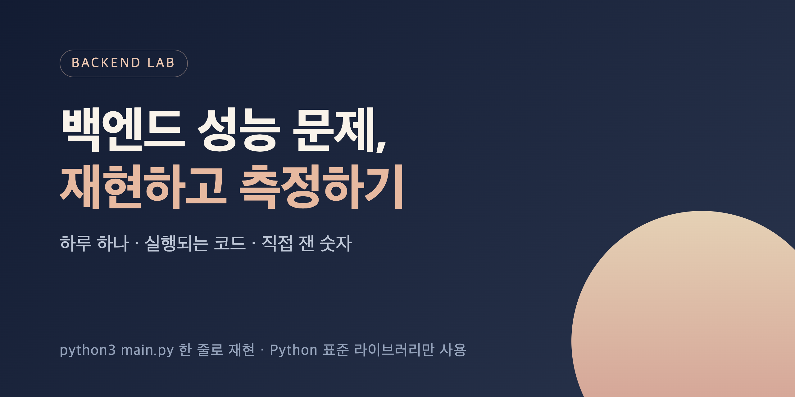

# backend-lab



Small, runnable experiments that reproduce and measure backend performance problems: N+1, indexes, paging, MyBatis.

### 30초 실행

```bash
git clone https://github.com/morningverse67-wq/backend-lab.git && cd backend-lab
python3 labs/001-n-plus-one/main.py      # N+1: 쿼리 501번 vs 1번 (Python 3, 설치 없음)
python3 labs/002-index-scan/main.py      # 인덱스 vs 풀 스캔
```

MyBatis + MySQL 버전(Java 21, Maven, Docker)은 [labs/003-mybatis-nplusone](labs/003-mybatis-nplusone)의 한 줄 명령으로 실행한다.

백엔드에서 자주 만나는 데이터·성능 문제를 **작게 재현하고, 직접 측정해서, 기록**하는 실험실.

- 실험 하나 = 폴더 하나 (`labs/NNN-topic/`)
- 각 폴더에는 바로 실행되는 코드와 `README.md` (문제 → 실험 → 결과 → 배운 점)
- Python lab: 표준 라이브러리만 사용해서 `python3 main.py` 한 줄로 재현
- Java lab: Maven + Docker(MySQL)로 `mvn test` 재현. 실행 명령은 각 lab README에
- 수치는 직접 돌린 값만 적는다. 환경에 따라 달라질 수 있음을 함께 표시

## Labs

| # | 주제 | 한 줄 요약 | 실행 | Velog 글 |
|---|---|---|---|---|
| 001 | [N+1 쿼리](labs/001-n-plus-one) | 쿼리 501번 vs 1번. 비용의 대부분은 실행이 아니라 왕복 | Python | [MyBatis N+1 문제 해결, 로그 확인부터 일대다 페이징까지](https://velog.io/@morningverse/N1-쿼리는-왜-생길까) |
| 002 | [인덱스 vs 풀 스캔](labs/002-index-scan) | 선택적 조회는 887배 빨라지고, 90%를 읽는 조회는 0.9배 | Python | 후속 글 후보 |
| 003 | [MyBatis N+1 (MySQL)](labs/003-mybatis-nplusone) | 중첩 select 21번 → join resultMap 1번, 부모 페이징 + IN 2번. `<id>` 대신 `<result>`면 약 11~19% 느림 | Java | [MyBatis N+1 문제 해결, 로그 확인부터 일대다 페이징까지](https://velog.io/@morningverse/N1-쿼리는-왜-생길까) |
| 004 | [복합 인덱스 컬럼 순서](labs/004-composite-index-order) | 같은 두 컬럼도 순서에 따라 505배 차이. 등호 컬럼 먼저, 범위 컬럼 나중. 날짜만 조회하면 반대로 10.6배 | Python | 후속 글 후보 |
| 005 | [OFFSET vs 커서 페이징](labs/005-offset-vs-keyset-paging) | 10,000페이지 100회 조회 합계 OFFSET 187.96ms vs 커서 0.77ms(244.7배). 대신 특정 페이지로 바로 이동은 OFFSET이 52.3배 빠름 | Python | 후속 글 후보 |
| 006 | [인덱스를 못 타는 쿼리](labs/006-non-sargable-queries) | 인덱스는 그대로, WHERE만 고쳐서 날짜 함수 41.3배, `LIKE '%-1234'` 876.4배 (각 100회 조회 합계). 식 인덱스는 같은 식에만 효과 | Python | 후속 글 후보 |
| 007 | [커버링 인덱스](labs/007-covering-index) | 테이블을 안 읽으니 한 달 합계 10회 82.20ms → 4.95ms(16.6배). 인덱스 밖 컬럼을 하나라도 조회하면 1.0배, 인덱스 크기는 1.71배 | Python | 후속 글 후보 |

다음 주제는 [ROADMAP.md](ROADMAP.md)에.

## Links

- Blog: [velog.io/@morningverse](https://velog.io/@morningverse)
- 면접 질문별 정리: [backend-interview-lab](https://github.com/morningverse67-wq/backend-interview-lab)
