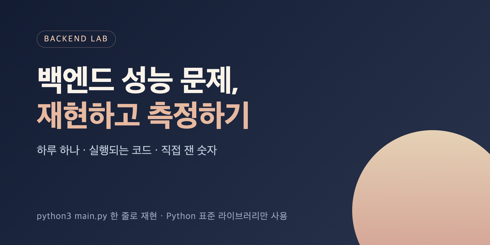

# backend-lab



Small, runnable experiments that reproduce and measure backend performance problems: N+1, indexes, paging, MyBatis.

### 30초 실행

```bash
git clone https://github.com/morningverse67-wq/backend-lab.git && cd backend-lab
python3 labs/001-n-plus-one/main.py      # N+1: 쿼리 501번 vs 1번 (Python 3, 설치 없음)
python3 labs/002-index-scan/main.py      # 인덱스 vs 풀 스캔
```

MyBatis + MySQL 버전(Java 21, Maven, Docker)은 [labs/003-mybatis-nplusone](labs/003-mybatis-nplusone)의 한 줄 명령으로 실행한다.

백엔드에서 자주 만나는 데이터·성능 문제를 **작게 재현하고, 직접 측정해서, 기록**하는 실험실.

- 실험 하나 = 폴더 하나 (`labs/NNN-topic/`)
- 각 폴더에는 바로 실행되는 코드와 `README.md` (문제 → 실험 → 결과 → 배운 점)
- Python lab: 표준 라이브러리만 사용해서 `python3 main.py` 한 줄로 재현
- Java lab: Maven + Docker(MySQL)로 `mvn test` 재현. 실행 명령은 각 lab README에
- 수치는 직접 돌린 값만 적는다. 환경에 따라 달라질 수 있음을 함께 표시

## Labs

| # | 주제 | 한 줄 요약 | 실행 | Velog 글 |
|---|---|---|---|---|
| 001 | [N+1 쿼리](labs/001-n-plus-one) | 쿼리 501번 vs 1번. 비용의 대부분은 실행이 아니라 왕복 | Python | [MyBatis N+1 문제 해결, 로그 확인부터 일대다 페이징까지](https://velog.io/@morningverse/N1-쿼리는-왜-생길까) |
| 002 | [인덱스 vs 풀 스캔](labs/002-index-scan) | 선택적 조회는 887배 빨라지고, 90%를 읽는 조회는 0.9배 | Python | 후속 글 후보 |
| 003 | [MyBatis N+1 (MySQL)](labs/003-mybatis-nplusone) | 중첩 select 21번 → join resultMap 1번, 부모 페이징 + IN 2번. `<id>` 대신 `<result>`면 약 11~19% 느림 | Java | [MyBatis N+1 문제 해결, 로그 확인부터 일대다 페이징까지](https://velog.io/@morningverse/N1-쿼리는-왜-생길까) |
| 004 | [복합 인덱스 컬럼 순서](labs/004-composite-index-order) | 같은 두 컬럼도 순서에 따라 505배 차이. 등호 컬럼 먼저, 범위 컬럼 나중. 날짜만 조회하면 반대로 10.6배 | Python | 후속 글 후보 |
| 005 | [OFFSET vs 커서 페이징](labs/005-offset-vs-keyset-paging) | 10,000페이지 100회 조회 합계 OFFSET 187.96ms vs 커서 0.77ms(244.7배). 대신 특정 페이지로 바로 이동은 OFFSET이 52.3배 빠름 | Python | 후속 글 후보 |
| 006 | [인덱스를 못 타는 쿼리](labs/006-non-sargable-queries) | 인덱스는 그대로, WHERE만 고쳐서 날짜 함수 41.3배, `LIKE '%-1234'` 876.4배 (각 100회 조회 합계). 식 인덱스는 같은 식에만 효과 | Python | 후속 글 후보 |
| 007 | [커버링 인덱스](labs/007-covering-index) | 테이블을 안 읽으니 한 달 합계 10회 82.20ms → 4.95ms(16.6배). 인덱스 밖 컬럼을 하나라도 조회하면 1.0배, 인덱스 크기는 1.71배 | Python | 후속 글 후보 |
| 008 | [대량 INSERT](labs/008-bulk-insert) | 1만 건을 한 건마다 COMMIT 1,948.84ms → 트랜잭션 하나 8.08ms(241.2배). 1,000건 단위 커밋도 10.16ms. 대신 하나로 묶으면 1건 실패에 0건이 남음 | Python | 후속 글 후보 |
| 009 | [COUNT(*) 비용과 대안](labs/009-count-cost) | 100만 건 중 59.9만 건 세기: 인덱스 없음 21.16ms, 인덱스 6.12ms, 트리거 카운터 0.0005ms. 대신 카운터 때문에 INSERT 2.90배·DELETE 4.73배 느려짐. 있는지만 볼 땐 EXISTS, 단 결과가 없으면 1.0배 | Python | 후속 글 후보 |
| 010 | [Lost update와 낙관적 락](labs/010-lost-update-optimistic-lock) | 한 행에 +1 요청 1,600번: 락 없이 읽고-쓰기는 최종 값 200(1,400건 유실), `version` 낙관적 락은 1,600. 대신 재시도 5,995번에 시간 2.09배, 요청이 흩어지면 1.03배 | Python | 후속 글 후보 |
| 011 | [비관적 락과 트레이드오프](labs/011-pessimistic-lock) | 한 행에 +1 요청 1,600번: 행을 먼저 잠그면 재시도 0번, p99 174.32ms → 18.92ms. 전체 시간은 2,767.2ms vs 2,771.7ms로 같고 중앙값은 1.66ms → 13.62ms. 락 하나로 전부 묶으면 흩어진 요청도 2.49배 느려짐 | Python | 후속 글 후보 |
| 012 | [재고 차감 동시성](labs/012-stock-decrement-concurrency) | 재고 100개에 주문 400건: 읽고-쓰기는 400개를 팔고(300개 초과), `qty - 1`만 바꾸면 107개에 재고 -7. 원자적 UPDATE는 정확히 100개, 주문 800건은 락보다 2.17배 빠름(634.9ms vs 1,379.7ms). 대신 장바구니처럼 여러 행이면 트랜잭션 필요 | Python | 후속 글 후보 |
| 013 | [격리 수준 현상](labs/013-isolation-anomalies) | A를 읽고 0.2ms 뒤 B를 읽는 합계 보고서 1,000건 중 235건이 틀림(문장마다 다른 시점을 읽음). 읽기 트랜잭션으로 묶으면 0건, 시간은 같음(p50 0.315ms vs 0.314ms). 대신 스냅샷을 열어 두면 커밋 3,000번에 WAL 3.93MB → 11.79MB(3.0배) | Python | 후속 글 후보 |
| 014 | [멱등성 키로 중복 결제 막기](labs/014-idempotency-key) | 같은 결제 요청 3번씩 주문 200건: 키를 먼저 조회하면 DB 행은 200건인데 PG 결제는 599번, 결제 전에 키부터 저장하면 200번. 재시도는 같은 키여야 함(시도마다 새 키면 400번). 대가는 요청당 0.148ms, PG 2ms 포함 1.22배 | Python | [이벤트 중복 처리, SQLite DO NOTHING 뒤 집계가 늘어나는 함정](https://velog.io/@morningverse/sqlite-event-dedup-returning-count) |
| 015 | [데드락과 락 순서 고정](labs/015-deadlock-lock-order) | 계좌 2개 사이 이체 200건을 양방향으로: 순서 없이 잠그면 데드락 250번에 521.0ms(감지 없이 30ms 타임아웃만 쓰면 6,658.9ms), id 작은 계좌부터 잠그면 0번에 345.1ms. 계좌 1,000개로 흩어지면 셋 다 0번, 1.0배 | Python | 후속 글 후보 |
| 016 | [캐시 없음 vs LRU 캐시](labs/016-lru-cache-latency) | 상품 페이지 2만 건: 인기 상품에 몰리면 LRU 1,000개로 209.6ms → 77.5ms(히트 67.1%, 2.70배), 고르게 흩어지면 1.07배(히트 9.7%). p50은 0.0104 → 0.0001ms인데 p99는 거의 그대로. 요청 2%가 쓰기면 무효화 없이 36.3%가 옛 값 | Python | 후속 글 후보 |
| 017 | [Cache stampede와 single-flight](labs/017-cache-stampede-single-flight) | 캐시 만료 순간 같은 키로 요청 32개: 각자 쿼리하면 32번에 140.6ms(p99 161.63ms), single-flight로 합치면 1번에 16.6ms(8.5배). 키 32개로 흩어지면 0.91배로 이득 없음. SWR은 p99 0.47ms 대신 만료된 값을 줌 | Python | 후속 글 후보 |
| 018 | [TTL + jitter로 동시 만료 피하기](labs/018-ttl-jitter) | 키 1,000개를 같은 TTL 60초로 한꺼번에 채우면 60초마다 만료가 몰려 가장 바쁜 1초에 DB 조회 592번. TTL에 0~20%를 더하면 96번(±20%는 52번), 전체 조회 수는 거의 같음 | Python | 후속 글 후보 |
| 019 | [캐시 쓰기 전략](labs/019-cache-write-policies) | 키 10개에 쓰기 100번: cache-aside 읽기 미스 100번, write-through 0번. 키별 병합 write-behind는 UPDATE 50번, 대신 95번째 응답 후 캐시 유실 시 DB에 최신 값 없는 키 10개 | Python | 후속 글 후보 |
| 020 | [Rate limiter](labs/020-rate-limiter) | 999/1000ms 경계 요청 10개: fixed window 허용 10개, exact sliding log·token bucket 5개. 0/800ms burst는 token bucket 9개로 strict rolling 한도와 다름 | Python | 후속 글 후보 |
| 021 | [재시도 + 지수 백오프 + jitter](labs/021-retry-backoff-jitter) | 1초 장애 뒤 클라이언트 100개 재시도: 지수 백오프만 쓰면 계속 함께 몰려 복구 후 거절 450번, 마지막 성공 28,700ms. full jitter면 거절 9번, 4,048ms(100 seed low median) | Python | 후속 글 후보 |
| 022 | [Circuit breaker 상태 전이](labs/022-circuit-breaker) | 초당 100개 요청, 1초 타임아웃: 장애 중 타임아웃 호출이 breaker 없음 550번 → 109~118번(장애 길이 901가지 low median). 대신 복구 후 거절 OPEN 500ms 75개, 5000ms 330개. 동시에 매달린 호출은 모두 100개 | Python | 후속 글 후보 |
| 023 | [커넥션 풀 크기와 대기 시간](labs/023-connection-pool-size) | 4코어 DB, 초당 800개: 풀 2개는 2,478개가 커넥션 대기 1초 뒤 포기, 4개부터 0개. 그 위로는 대기 장소만 DB로 옮겨 p99 25.80 → 40.86ms. 쿼리 뒤 20ms 더 쥐면 16개도 805개 포기(평균 사용 21.5개) | Python | 후속 글 후보 |
| 024 | [동기 vs 스레드 풀 vs asyncio](labs/024-sync-threadpool-asyncio) | 50ms 서버에 호출 100번: 순차 5,281.5ms, 스레드 100개 60.5ms, asyncio gather 65.3ms. 같은 동시 수면 비슷(16개: 379.7 vs 383.1ms). `async def` 안 블로킹 호출은 5,254.4ms. CPU 반복문을 붙이면 스레드 100개도 579.2ms | Python | 후속 글 후보 |
| 025 | [타임아웃 없는 외부 호출](labs/025-external-call-timeout) | 워커 8개, 외부 API가 2초 멈춤: 타임아웃 없으면 상관없는 `/health`도 최대 6,437.2ms, 읽기 타임아웃 200ms면 0.3ms(주문은 202.1ms에 504). 연결 타임아웃만은 6,439.1ms로 같고, 100ms마다 1바이트씩 오면 읽기 타임아웃도 6,564.7ms. 전체 기한을 둬야 끊김 | Python | 후속 글 후보 |
| 026 | [대용량 CSV: 한 번에 읽기 vs 스트리밍](labs/026-csv-load-vs-streaming) | 주문 40만 행 23.4MB CSV: `list(csv.reader(f))`는 메모리 최대치 +187.2MB(DictReader +245.5MB), 한 행씩 읽으면 +0.1MB에 시간도 201.2 → 152.8ms. 중앙값처럼 값 전체가 필요하면 금액 열만 남겨 +24.8MB | Python | 후속 글 후보 |
| 027 | [정렬된 두 리스트 병합 vs 해시 조인](labs/027-merge-join-vs-hash-join) | 8만×2만 행 join: 이미 정렬된 입력에서 병합 195.8ms, 해시 57.0ms. 원본 입력을 정렬까지 하면 병합 200.2ms. 두 방식 결과 159,975행 일치 | Python | 후속 글 후보 |
| 028 | [직렬화 비용: json vs pickle vs struct](labs/028-serialization-json-pickle-struct) | 주문 10만 건: json 9.01MB, pickle 3.07MB, struct 2.10MB(4.29배). zlib 압축 뒤엔 1.50 vs 1.21MB로 1.24배. 필드를 추가하면 옛 struct 코드가 21건을 에러 없이 25건으로 잘못 읽음 | Python | 후속 글 후보 |
| 029 | [Bloom filter로 존재 여부 거르기](labs/029-bloom-filter) | 키 10만 개를 125KB(키당 10비트)에 넣자 90%가 없는 키인 조회 10만 건 중 저장소까지 간 조회가 10,728건. 오탐률 0.84%(공식 0.82%), 놓친 키 0. 2배를 넣으면 오탐률 13.88%, 비트를 지워 키 100개를 삭제하면 남은 키 486개가 '없음' | Python | 후속 글 후보 |
| 030 | [Consistent hashing과 키 이동량](labs/030-consistent-hashing) | 키 10만 개, 노드 10→11대: `hash % N`은 90.89%가 옮겨졌고, 가상 노드 100개 해시 링은 9.27%(이상값 9.09%)만 새 노드로. 가상 노드 없이 점 하나면 가장 바쁜 노드가 평균의 3.72배 | Python | 후속 글 후보 |
| 031 | [Transactional outbox](labs/031-transactional-outbox) | 주문 1만 건, 단계 사이 죽기 2%: 커밋 후 발행은 이벤트 197건 유실, 발행 후 커밋은 없는 주문 이벤트 317건. outbox는 유실·유령 0, 대신 216건 중복이라 소비자가 이벤트 id로 걸러 9,905건 처리 | Python | 후속 글 후보 |
| 032 | [멱등 소비자(inbox)](labs/032-idempotent-consumer) | 이벤트 1만 건, 재전송 3%·반영 뒤 죽기 2%: 그냥 반영 548건 초과, 반영 후 id 따로 기록 223건 초과, inbox와 반영을 한 트랜잭션에 넣으면 0 | Python | 후속 글 후보 |
| 033 | [Dead letter queue](labs/033-dead-letter-queue) | 메시지 1만 건 중 poison 129건, 시도 한도 12,000번: 제자리 무한 재시도는 정상 메시지 38건만 처리, 최대 3번 시도 뒤 DLQ는 정상 9,871건 모두 처리하고 DLQ에는 poison 129건만 | Python | 후속 글 후보 |

다음 주제는 [ROADMAP.md](ROADMAP.md)에.

## Links

- Blog: [velog.io/@morningverse](https://velog.io/@morningverse)
- 면접 질문별 정리: [backend-interview-lab](https://github.com/morningverse67-wq/backend-interview-lab)
