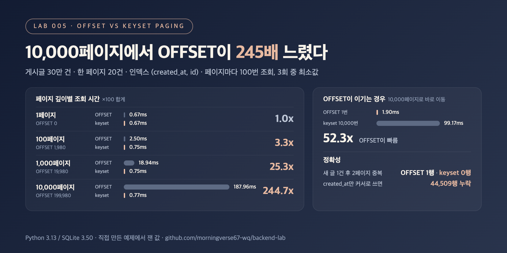

# 005. OFFSET 페이징 vs 커서(keyset) 페이징

> 1페이지에서는 차이가 없었는데, 10,000페이지에서는 OFFSET이 244.7배 느렸다(각 100회 조회 합계 187.96ms vs 0.77ms). 대신 "10,000페이지로 바로 이동"에서는 OFFSET이 52.3배 빨랐다.

## 문제

최신순 게시글 목록을 20건씩 보여준다. 가장 흔한 방법은 `OFFSET`이다.

```sql
-- OFFSET: 앞의 (page - 1) * 20건을 건너뛴다
SELECT id, created_at, title FROM posts
ORDER BY created_at DESC, id DESC
LIMIT 20 OFFSET ?;

-- 커서(keyset): 직전 페이지 마지막 행의 (created_at, id) 다음부터 읽는다
SELECT id, created_at, title FROM posts
WHERE (created_at, id) < (?, ?)
ORDER BY created_at DESC, id DESC
LIMIT 20;
```

`OFFSET 199980`은 DB가 199,980건을 실제로 읽고 버린다는 뜻이다. 페이지가 깊어질수록 얼마나 느려질까? 그리고 커서 방식은 항상 나을까?

## 실험

- 게시글 30만 건, `created_at`은 30일 범위의 분 단위 값이라 같은 시각에 평균 7건 정도가 몰린다 (SQLite in-memory, 시드 고정)
- 인덱스 `(created_at, id)` 하나, 한 페이지 20건
- 1, 100, 1,000, 10,000페이지를 OFFSET과 커서로 각각 100번씩 조회하고, 두 방식의 결과가 같은지 `assert`로 확인
- 1페이지를 읽은 뒤 새 글이 1건 들어오면 2페이지가 어떻게 되는지 확인
- 커서를 `(created_at, id)`로 쓸 때와 `created_at`만 쓸 때, 처음부터 끝까지 넘기면서 빠지는 행이 있는지 셈
- 커서 없이 10,000페이지로 바로 가야 하는 경우: OFFSET 한 번 vs 커서로 10,000페이지 넘기기

```bash
python3 main.py
```

## 결과



페이지 깊이별 (각 페이지 100번 조회 합계)

| 페이지 | 건너뛰는 행 | OFFSET (ms) | 커서 (ms) | 배율 |
|---:|---:|---:|---:|---:|
| 1 | 0 | 0.67 | 0.67 | 1.0x |
| 100 | 1,980 | 2.50 | 0.75 | 3.3x |
| 1,000 | 19,980 | 18.94 | 0.75 | 25.3x |
| 10,000 | 199,980 | 187.96 | 0.77 | 244.7x |

정확성과 이동

| 상황 | OFFSET | 커서 |
|---|---|---|
| 1페이지를 본 뒤 새 글 1건, 2페이지 | 1페이지 행 1건이 중복 | 중복 0건 |
| 전체 30만 건을 처음부터 끝까지 넘기기 | - | `(created_at, id)`: 300,000건 모두 (15,000페이지, 164ms) / `created_at`만: 44,509건 누락 |
| 커서 없이 10,000페이지로 바로 이동 | 쿼리 1번 1.90ms | 10,000페이지를 넘겨서 99.17ms (52.3배 느림) |

실행 계획

```text
OFFSET : SCAN posts USING INDEX idx_posts_created
커서   : SEARCH posts USING INDEX idx_posts_created (created_at<?)
```

<sub>Python 3.13 / SQLite 3.50, 3회 중 최소값. 환경에 따라 수치는 달라질 수 있음.</sub>

## 배운 점

- OFFSET은 건너뛸 행을 **읽은 다음 버린다**. 인덱스가 있어도 실행 계획은 `SCAN`이고, 시간이 건너뛰는 행 수에 거의 비례해서 늘었다(1,000페이지 18.94ms → 10,000페이지 187.96ms). 커서는 `SEARCH`로 시작 위치를 바로 찾아서 깊이와 상관없이 0.7ms대였다.
- 앞쪽 몇 페이지만 보는 화면이면 OFFSET도 충분하다. 1페이지는 두 방식이 0.67ms로 같았고 100페이지도 100번 합계 차이가 2ms가 안 됐다. 무한 스크롤, 배치 작업처럼 깊이 내려가는 경우에 커서의 이득이 커진다.
- 커서의 정렬 키는 **유일해야** 한다. `created_at`만 커서로 쓰면 페이지 경계에서 같은 시각의 나머지 행을 건너뛰어 30만 건 중 44,509건이 빠졌다. `id` 같은 유일한 컬럼을 뒤에 붙이고 인덱스도 같은 순서로 만든다.
- 커서는 "다음 페이지"만 알 수 있어서 "10,000페이지로 바로 이동"이 필요하면 OFFSET이 52.3배 빨랐다. 페이지 번호 UI가 꼭 필요하면 OFFSET을 쓰되 이동 가능한 페이지 수를 제한하거나, 앞쪽은 OFFSET 뒤쪽은 커서처럼 섞는 방법을 고민해야 한다.
