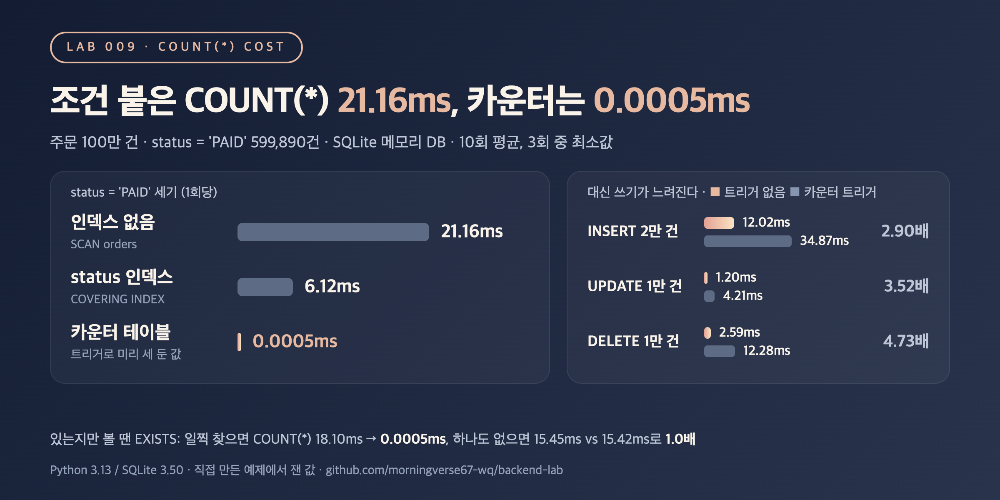

# 009. COUNT(*)는 왜 느려지고, 무엇으로 바꿀 수 있을까

> 주문 100만 건에서 `status = 'PAID'`를 세는 데 인덱스 없이 21.16ms, 인덱스로 6.12ms, 트리거로 미리 세 둔 카운터는 0.0005ms였다. 대신 카운터를 유지하느라 INSERT는 2.90배, DELETE는 4.73배 느려졌다.

## 문제

목록 화면마다 전체 개수를 같이 보여 주는 코드가 흔하다.

```sql
SELECT COUNT(*) FROM orders WHERE status = 'PAID';            -- "결제 완료 599,890건"
SELECT COUNT(*) FROM orders WHERE user_id = ? AND ...;        -- 있는지만 알고 싶은데 개수를 센다
```

`COUNT(*)`는 조건에 맞는 행(또는 인덱스 항목)을 하나하나 지나가야 답이 나온다. 그래서 데이터가 늘면 같이 느려진다. 인덱스를 걸면 얼마나 줄고, 개수를 따로 저장해 두면 무엇을 내줘야 할까?

## 실험

- 주문 1만 / 10만 / 100만 건, `user_id`에 인덱스 1개, 상태는 PAID 60% / SHIPPED 30% / CANCELLED 10% (SQLite in-memory, 시드 고정)
- 카운터 테이블 `order_counts(status, cnt)`를 두고 INSERT / UPDATE / DELETE 트리거로 상태별 개수와 전체 개수(`'*'`)를 갱신
- 측정 시간은 모두 **쿼리 1회당** 값이다(10회 실행 평균, 3회 중 최소값)
  1. 조건 없는 `COUNT(*)` vs 카운터 행 읽기 (1만 / 10만 / 100만 건)
  2. `COUNT(*) WHERE status = 'PAID'`: 인덱스 없음 vs `status` 인덱스 vs 카운터 테이블 (100만 건)
  3. "하나라도 있나?"를 `COUNT(*) > 0`과 `EXISTS`로 비교. 인덱스 없는 `amount` 컬럼에서, 금방 찾는 경우와 하나도 없는 경우
  4. 카운터의 대가: 10만 건에서 시작해 INSERT 2만 건, 상태 UPDATE 1만 건, DELETE 1만 건 시간을 트리거 유무로 비교
- 모든 방법의 결과가 같은지 `assert`로 확인하고, 쓰기가 끝난 뒤 카운터 값이 `COUNT(*) ... GROUP BY status`와 같은지도 확인

```bash
python3 main.py
```

## 결과



`COUNT(*) WHERE status = 'PAID'` (100만 건 중 599,890건, 1회당)

| 방법 | 실행 계획 | 시간 (ms) | 인덱스 없음 대비 |
|---|---|---:|---:|
| 인덱스 없음 | `SCAN orders` | 21.1568 | 1.0x |
| `status` 인덱스 | `SEARCH orders USING COVERING INDEX idx_orders_status (status=?)` | 6.1215 | 3.5x |
| 카운터 테이블 읽기 | 기본 키로 한 행 | 0.0005 | - |

조건 없는 `SELECT COUNT(*) FROM orders` (1회당)

| 행 수 | `COUNT(*)` (ms) | 카운터 행 읽기 (ms) | 배율 |
|---:|---:|---:|---:|
| 10,000 | 0.0006 | 0.0004 | 1.4x |
| 100,000 | 0.0044 | 0.0005 | 9.5x |
| 1,000,000 | 0.0573 | 0.0005 | 119.6x |

"하나라도 있나?" (인덱스 없는 `amount`, 100만 건, 1회당)

| 경우 | `COUNT(*) > 0` (ms) | `EXISTS` (ms) | 배율 |
|---|---:|---:|---:|
| 금방 찾음 (`amount >= 50000`, 결과 있음) | 18.1045 | 0.0005 | - |
| 하나도 없음 (`amount >= 1000000`) | 15.4496 | 15.4158 | 1.0x |

카운터 트리거의 쓰기 비용 (10만 건에서 시작, 작업 1번 전체 시간)

| 작업 | 트리거 없음 (ms) | 카운터 트리거 (ms) | 느려진 배율 |
|---|---:|---:|---:|
| INSERT 2만 건 | 12.02 | 34.87 | 2.90x |
| status UPDATE 1만 건 | 1.20 | 4.21 | 3.52x |
| DELETE 1만 건 | 2.59 | 12.28 | 4.73x |

<sub>Python 3.13 / SQLite 3.50, in-memory DB, 10회 평균의 3회 중 최소값. 0.0005ms는 파이썬에서 쿼리 한 번을 호출하는 비용과 비슷한 수준이라 그 값으로 나눈 배율은 표에 적지 않았다. 환경에 따라 수치는 달라질 수 있음.</sub>

## 배운 점

- 조건 붙은 `COUNT(*)`는 결국 맞는 행을 다 지나간다. 인덱스를 걸면 테이블 대신 더 작은 인덱스만 읽어서 21.16ms → 6.12ms(3.5배)가 됐지만, 59.9만 개 항목을 세는 일 자체는 그대로라 데이터가 늘면 다시 느려진다.
- 개수를 미리 세 둔 카운터 테이블은 한 행만 읽으니 데이터 크기와 상관없이 0.0005ms 수준이었다. 대신 쓰기마다 트리거가 카운터를 고쳐서 INSERT 2.90배, UPDATE 3.52배, DELETE 4.73배 느려졌다. 여러 요청이 동시에 같은 카운터 행을 고치면 그 행에서 서로 기다리는 문제도 생긴다(여기서는 재지 않음). 그리고 미리 정해 둔 기준(상태별)만 셀 수 있어서, 기간이나 사용자 같은 임의 조건에는 쓸 수 없다.
- 조건 없는 전체 개수는 SQLite에서 이미 빨랐다(100만 건 0.0573ms). 실행 계획은 `SCAN orders USING COVERING INDEX idx_orders_user`로, 가장 작은 인덱스를 훑어서 센다. 1만 건이면 카운터와의 차이가 0.0002ms라 카운터를 둘 이유가 없다. 반면 MySQL InnoDB는 트랜잭션마다 보이는 행이 달라 전체 행 수를 따로 들고 있지 않으므로, 결과는 DB마다 다를 수 있다(여기서는 재지 않음).
- 있는지만 알면 될 때는 `EXISTS`가 첫 번째로 맞는 행에서 멈춘다. 금방 찾는 경우 18.10ms → 0.0005ms였다. 하지만 맞는 행이 하나도 없으면 끝까지 읽어야 해서 15.45ms vs 15.42ms로 같았다. 이때 필요한 건 `EXISTS`가 아니라 조건 컬럼의 인덱스다.
