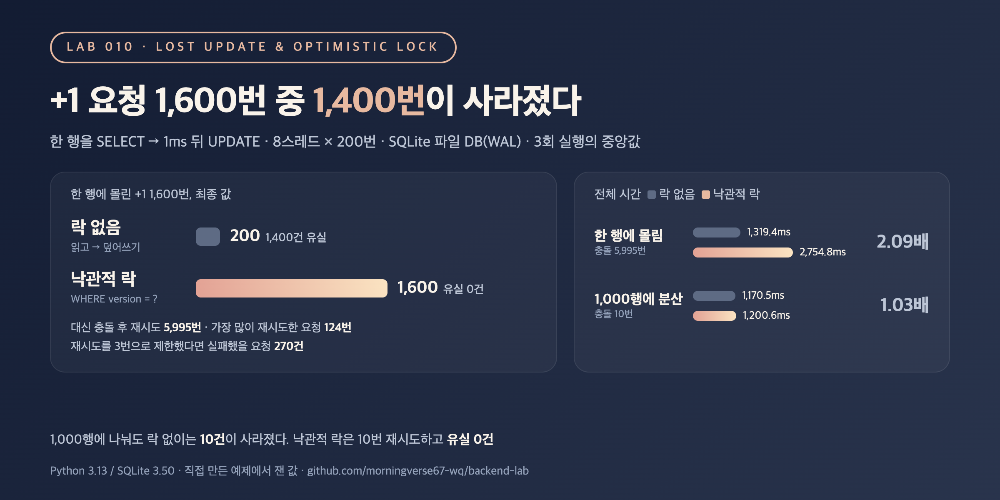

# 010. Lost update는 어떻게 생기고, 낙관적 락은 언제까지 버틸까

> 한 행에 `+1` 요청을 1,600번 보냈는데 최종 값은 200이었다. `version` 컬럼으로 낙관적 락을 걸자 1,600이 됐지만, 그 대가로 5,995번 재시도했고 전체 시간은 2.09배가 됐다.

## 문제

값을 읽어서 애플리케이션에서 바꾼 뒤 다시 쓰는 코드는 흔하다.

```sql
SELECT qty FROM items WHERE id = 1;          -- 10을 읽음
-- 애플리케이션에서 qty + 1 계산
UPDATE items SET qty = 11 WHERE id = 1;      -- 계산한 값으로 덮어씀
```

두 요청이 같은 10을 읽으면 둘 다 11을 쓴다. 두 번 더했는데 한 번만 남는다. 에러도 나지 않아서 로그로는 알기 어렵다.
낙관적 락은 읽을 때 본 `version`이 그대로일 때만 쓰게 해서 이걸 막는다.

```sql
SELECT qty, version FROM items WHERE id = 1;                       -- qty 10, version 3
UPDATE items SET qty = 11, version = version + 1
 WHERE id = 1 AND version = 3;                                     -- 바뀐 행이 0이면 다시 읽고 재시도
```

## 실험

- SQLite 파일 DB(WAL 모드), 요청마다 `SELECT` → 1ms 대기 → `UPDATE`. 1ms는 읽고 나서 쓰기 전까지 애플리케이션이 일하는 시간을 흉내 낸 것이다
- 먼저 스레드 없이 연결 2개로 순서를 직접 정해서 lost update와, 낙관적 락이 늦게 온 쓰기를 거절하는 과정을 재현
- 그다음 8스레드 x 200번 = `+1` 요청 1,600번을 동시에 보낸다
  - 방법: 락 없이 읽고-쓰기 / 낙관적 락(`WHERE version = ?`, 바뀐 행이 0이면 다시 읽고 재시도, 횟수 제한 없음)
  - 경우: 모든 요청이 한 행에 몰림 / 1,000행 중 무작위 행에 흩어짐
- 기대값은 항상 1,600. 최종 합계, 사라진 요청 수, 충돌(재시도) 수, 한 요청의 최대 재시도 수, 전체 시간을 잰다
- 각 경우를 3번 돌려 지표별 중앙값을 적었다. 낙관적 락은 매번 최종 값이 1,600이고 `version` 합계도 1,600인지 `assert`로 확인

```bash
python3 main.py
```

## 결과



연결 2개로 순서를 정해 재현 (둘 다 `qty = 0`에서 `+1`)

| 방법 | A의 UPDATE | B의 UPDATE | 최종 qty |
|---|---|---|---:|
| 락 없이 읽고-쓰기 | 1을 씀 | 1을 씀 | 1 (한 번 사라짐) |
| 낙관적 락 | 1행 바뀜 | 0행 바뀜 → 다시 읽고 재시도 | 2 |

동시 요청 1,600번 (8스레드 x 200번, 3회 실행의 지표별 중앙값)

| 경우 | 방법 | 최종 값 | 사라진 요청 | 충돌(재시도) | 한 요청 최대 재시도 | 재시도 4번 이상 요청 | 전체 시간 (ms) |
|---|---|---:|---:|---:|---:|---:|---:|
| 한 행에 몰림 | 락 없음 | 200 | 1,400 | - | - | - | 1,319.4 |
| 한 행에 몰림 | 낙관적 락 | 1,600 | 0 | 5,995 | 124 | 270 | 2,754.8 |
| 1,000행에 흩어짐 | 락 없음 | 1,590 | 10 | - | - | - | 1,170.5 |
| 1,000행에 흩어짐 | 낙관적 락 | 1,600 | 0 | 10 | 1 | 0 | 1,200.6 |

<sub>Python 3.13 / SQLite 3.50, 파일 DB(WAL, synchronous=NORMAL). 회차별 값: 한 행 락 없음 유실 1,400 / 1,400 / 1,400, 낙관적 락 재시도 5,995 / 6,147 / 5,775, 흩어짐 락 없음 유실 7 / 10 / 10. 스레드 실행 순서에 따라 매번 조금씩 달라지고, 환경에 따라 수치는 달라질 수 있음.</sub>

## 배운 점

- 한 행에 몰리면 락 없는 읽고-쓰기는 거의 다 틀린다. 8개 스레드가 같은 순간에 같은 값을 읽고 1ms 뒤에 같은 값을 써서, 8번 더해도 1번만 남았다(1,600 → 200). 1,000행에 흩어져 충돌이 드물어도 10건이 사라졌다. 드물다는 것이 0이라는 뜻은 아니다.
- 낙관적 락은 세 경우 모두 유실 0건이었다. 비용은 충돌 수에 비례한다. 흩어진 경우는 재시도 10번, 시간 1.03배로 거의 공짜였다. 한 행에 몰린 경우는 재시도 5,995번(요청 1건당 평균 3.7번), 전체 시간 2.09배였다. 재시도마다 다시 읽고 다시 기다려야 하기 때문이다.
- 재시도 횟수를 제한하면 그만큼 실패가 생긴다. 한 행에 몰린 경우 가장 운 나쁜 요청은 124번 재시도했고, 3번으로 제한했다면 270건(16.9%)이 실패로 끝났을 것이다. 낙관적 락을 쓰면 "재시도 몇 번, 그다음엔 어떤 에러로 돌려줄지"까지 정해야 한다.
- 그래서 낙관적 락은 충돌이 드문 곳(서로 다른 행을 고치는 게시글 수정, 설정 변경 등)에 맞고, 같은 행에 요청이 몰리는 곳(인기 상품 재고, 공용 카운터)에는 맞지 않는다. 그런 곳은 비관적 락으로 줄을 세우거나, `qty = qty + 1`처럼 DB가 한 문장 안에서 계산하게 하는 편이 낫다(다음 lab들에서 잰다). MySQL에서는 재지 않았지만, 읽기와 쓰기를 따로 보내는 구조라면 격리 수준 기본값에서 같은 문제가 생긴다.
