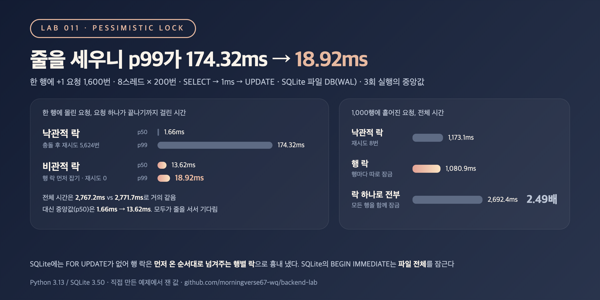

# 011. 비관적 락은 낙관적 락보다 빠를까

> 한 행에 `+1` 요청 1,600번을 보내면 낙관적 락은 5,624번 재시도했다. 행을 먼저 잠그고 줄을 세우자 재시도는 0번, 느린 쪽 1% 요청의 지연(p99)은 174.32ms에서 18.92ms가 됐다. 그런데 전체 시간은 2,767.2ms와 2,771.7ms로 거의 같았다.

## 문제

[lab 010](../010-lost-update-optimistic-lock)에서 낙관적 락은 유실 0건이었지만, 한 행에 요청이 몰리자 재시도가 수천 번 생겼다.
비관적 락은 읽기 전에 행을 먼저 잠근다. 다른 요청은 충돌한 뒤 다시 하는 대신, 락이 풀릴 때까지 기다린다.

```sql
BEGIN;
SELECT qty FROM items WHERE id = 1 FOR UPDATE;   -- 이 행을 잠금. 같은 행을 잠그려는 다른 트랜잭션은 여기서 대기
UPDATE items SET qty = 11 WHERE id = 1;
COMMIT;                                          -- 락이 풀리고 다음 요청이 같은 행을 읽음
```

궁금한 것은 두 가지다. 같은 행에 몰릴 때 기다리는 쪽이 재시도보다 나은가, 그리고 락을 넓게 잡으면 얼마나 손해인가.

## 실험

- SQLite 파일 DB(WAL 모드), lab 010과 같은 조건: 요청마다 `SELECT` → 1ms 대기 → `UPDATE`, 8스레드 x 200번 = `+1` 요청 1,600번
- SQLite에는 `SELECT ... FOR UPDATE`가 없다. SQLite가 미리 잡을 수 있는 쓰기 락(`BEGIN IMMEDIATE`)은 행이 아니라 DB 파일 전체를 잠근다. 먼저 연결 2개로 이걸 직접 확인한다
- 그래서 동시 요청 실험에서는 행 락을 애플리케이션에서 흉내 냈다. 행마다 락을 하나씩 두고, 읽기 전에 잡고 쓰기가 끝나면 푼다. 기다리는 요청에는 먼저 온 순서대로 락을 넘겨준다
- 비교한 방법
  - 낙관적 락: `UPDATE ... WHERE version = ?`, 바뀐 행이 0이면 다시 읽고 재시도 (lab 010과 같음)
  - 행 락(비관적 락): 행마다 따로 잠금
  - 락 하나로 전부: 모든 행이 락 하나를 같이 씀. 넓게 잡은 락을 흉내 낸 것
- 경우: 모든 요청이 한 행에 몰림 / 1,000행 중 무작위 행에 흩어짐
- 전체 시간과 함께, 요청 하나가 끝나기까지 걸린 시간(기다린 시간과 재시도 포함)의 p50, p99, 최대값을 잰다
- 각 경우를 3번 돌려 지표별 중앙값을 적었다. 모든 방법에서 매번 최종 합계가 1,600이고 `version` 합계도 1,600인지 `assert`로 확인

```bash
python3 main.py
```

## 결과



SQLite `BEGIN IMMEDIATE`로 연결 2개 재현 (A가 먼저 쓰기 락을 잡은 상태)

| B가 한 일 | 결과 |
|---|---|
| 그냥 `SELECT` (행 1) | 기다리지 않고 옛 값 0을 읽음 |
| `BEGIN IMMEDIATE` (행 1을 고치려고) | `database is locked` |
| `BEGIN IMMEDIATE` (다른 행 2를 고치려고) | `database is locked` (파일 전체가 잠김) |
| A가 COMMIT한 뒤 `BEGIN IMMEDIATE` | 락을 얻고 A가 쓴 1을 읽어 2로 씀 |

동시 요청 1,600번 (8스레드 x 200번, 3회 실행의 지표별 중앙값, 지연은 요청 하나 기준)

| 경우 | 방법 | 사라진 요청 | 재시도 | 전체 시간 (ms) | p50 (ms) | p99 (ms) | 최대 (ms) |
|---|---|---:|---:|---:|---:|---:|---:|
| 한 행에 몰림 | 낙관적 락 | 0 | 5,624 | 2,767.2 | 1.66 | 174.32 | 424.06 |
| 한 행에 몰림 | 행 락(비관적 락) | 0 | 0 | 2,771.7 | 13.62 | 18.92 | 25.26 |
| 1,000행에 흩어짐 | 낙관적 락 | 0 | 8 | 1,173.1 | 1.73 | 47.72 | 794.51 |
| 1,000행에 흩어짐 | 행 락(비관적 락) | 0 | 0 | 1,080.9 | 1.74 | 49.44 | 361.42 |
| 1,000행에 흩어짐 | 락 하나로 전부 | 0 | 0 | 2,692.4 | 13.44 | 14.46 | 16.29 |

<sub>Python 3.13 / SQLite 3.50, 파일 DB(WAL, synchronous=NORMAL). 회차별 전체 시간(ms): 한 행 낙관적 2,789 / 2,734 / 2,767, 한 행 행 락 2,772 / 2,774 / 2,706, 흩어짐 행 락 1,336 / 1,081 / 1,053, 흩어짐 락 하나 2,678 / 2,713 / 2,692. 낙관적 락 재시도: 한 행 5,361 / 5,716 / 5,624. 스레드 실행 순서에 따라 매번 조금씩 달라지고, 환경에 따라 수치는 달라질 수 있음.</sub>

## 배운 점

- 한 행에 몰리면 비관적 락은 재시도를 없애고 지연을 고르게 만든다. 낙관적 락은 운 좋은 요청은 1.66ms에 끝났지만, 느린 쪽 1%는 174.32ms, 가장 느린 요청은 424.06ms를 기다렸다. 행 락은 p99 18.92ms, 최대 25.26ms였다. 먼저 온 순서대로 처리하니 오래 밀리는 요청이 없었다.
- 그렇다고 빨라지지는 않았다. 전체 시간은 2,767.2ms와 2,771.7ms로 같았다. 한 행에 대한 쓰기는 어느 방법이든 결국 한 번에 하나씩이라, 처리량은 "락을 잡고 있는 시간 x 요청 수"로 정해진다. 그리고 모두가 줄을 서니 중앙값은 1.66ms에서 13.62ms로 늘었다. 락을 잡은 채 외부 API를 부르는 식으로 잡고 있는 시간이 길어지면, 뒤에 선 요청 전부가 그만큼 더 기다린다.
- 락 범위가 넓으면 충돌이 없어도 줄을 선다. 1,000행에 흩어진 요청은 행 락이면 1,080.9ms였지만, 락 하나로 전부 묶으면 2,692.4ms(2.49배)로 한 행에 몰린 경우와 비슷해졌다. SQLite의 `BEGIN IMMEDIATE`가 파일 전체를 잠그는 것도 같은 문제다. MySQL InnoDB도 `FOR UPDATE`의 조건에 맞는 인덱스가 없으면 훑은 행을 모두 잠근다고 문서에 나와 있다(MySQL에서는 재지 않았다).
- 흩어진 경우 p99가 40ms대로 오히려 높은 것은 SQLite가 쓰기를 파일 단위로 한 번에 하나만 받기 때문으로 보인다. 서로 다른 행을 고쳐도 `UPDATE`끼리 잠깐 기다리고, SQLite는 이때 잠깐 잠들었다가 다시 시도한다. 락 하나로 묶은 경우는 애플리케이션에서 이미 한 줄로 세워서 이 대기가 없었다. 이 부분은 SQLite 특성이라 다른 DB에서는 다르게 나올 수 있다.
- 정리하면, 같은 행에 몰리고 재시도 실패나 긴 꼬리 지연을 감당하기 어려운 곳(인기 상품 재고, 좌석 예약)은 비관적 락이 맞다. 단, 락은 인덱스로 찾은 행에만 좁게 잡고, 잡고 있는 시간은 짧게 해야 한다. 충돌이 드문 곳은 낙관적 락으로도 충분했다(재시도 8번). `+1`처럼 DB가 한 문장 안에서 계산할 수 있는 변경은 락 없이 원자적 `UPDATE`로 끝낼 수 있는지 먼저 본다(다음 lab에서 잰다).
