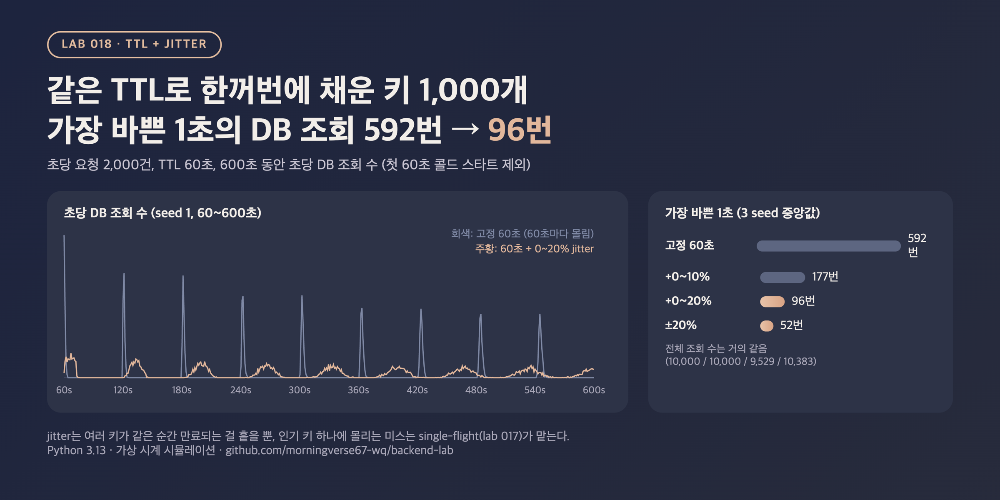

# 018. TTL + jitter로 동시 만료 피하기

> 키 1,000개를 같은 TTL 60초로 한꺼번에 채웠더니, 60초마다 만료가 한 초에 몰려 가장 바쁜 1초에 DB 조회가 592번 일어났다. TTL에 0~20%를 무작위로 더하자 같은 자리가 96번으로 줄었고, 전체 조회 수는 거의 그대로였다.

## 문제

배포 직후나 캐시를 비운 직후에는 많은 키가 거의 같은 시각에 채워진다.

```python
cache.set(key, value, ttl=60)   # 모든 키에 같은 60초
```

TTL이 모두 같으면 이 키들은 60초 뒤 거의 같은 시각에 만료된다. 다시 채울 때도 같은 60초를 주므로, 몰려서 만료되는 일이 60초마다 되풀이된다. 키마다 DB 조회는 1번이라도, 그게 한 초에 수백 개가 모이면 그 순간 DB가 바빠진다. 017의 stampede가 키 하나에 요청이 몰리는 문제라면, 이건 키 여러 개가 같은 순간 만료되는 문제다.

## 실험

- 가상 시계로 600초를 돌린다. 키 1,000개, 초당 요청 2,000건(키마다 고르게 무작위). t=0에 캐시가 비어 있어 처음 1분 안에 모든 키가 채워진다
- 미스가 나면 DB 조회 1번으로 세고, 그 키에 새 TTL을 준다. TTL 정책 네 가지를 비교했다
  - 고정 60초
  - 60초 + 0~10%, 60초 + 0~20%(늘리기만 함)
  - 60초 ±20%(줄 수도 있음)
- 초마다 DB 조회 수를 세서, 콜드 스타트인 첫 60초를 뺀 나머지에서 가장 바쁜 1초(peak), 상위 1% 초(p99), 평균, 전체 조회 수, 히트율을 봤다. 난수 seed 3개의 지표별 중앙값
- 조회 1번의 비용은 SQLite 상품 20만 건에서 카테고리 집계 쿼리를 200번 돌린 중앙값(2.20ms)으로 쟀고, 가장 바쁜 1초의 DB 작업 시간을 `peak × 2.20ms`로 어림했다

```bash
python3 main.py
```

## 결과



600초, 첫 60초 제외. 초당 DB 조회 수 기준

| TTL | 가장 바쁜 1초 | p99 초 | 평균 | 전체 조회 | 히트율 | 가장 바쁜 1초의 DB 작업 (어림) |
|---|---:|---:|---:|---:|---:|---:|
| 고정 60초 | 592 | 331 | 16.7 | 10,000 | 99.17% | 1,300.7ms |
| 60초 + 0~10% | 177 | 135 | 16.7 | 10,000 | 99.17% | 388.9ms |
| 60초 + 0~20% | 96 | 81 | 15.8 | 9,529 | 99.21% | 210.9ms |
| 60초 ±20% | 52 | 45 | 16.5 | 10,383 | 99.13% | 114.3ms |

고정 60초에서 초당 조회 수 (seed 1)

| 구간 | 초마다 |
|---|---|
| 60~66초 | 618, 301, 67, 14, 0, 0, 0 |
| 120~126초 | 334, 454, 160, 48, 3, 1, 0 |
| 540~546초 | 0, 12, 67, 203, 277, 201, 125 |

<sub>Python 3.13 / SQLite 3.50, CPU 10개. 실제 캐시 서버와 DB에 부하를 건 게 아니라 가상 시계로 만료와 미스를 센 시뮬레이션이다. 요청은 키마다 고르게 오고, 미스 처리는 즉시 끝난다고 가정했다(조회 중 같은 키로 온 요청이 겹치는 경우는 017에서 다룸). DB 작업 시간은 쿼리 1개 시간에 조회 수를 곱한 어림값이고(쿼리 시간은 다시 돌렸을 때 2.16ms로 조금 변함, 조회 수는 seed가 같으면 같음), 동시에 돌 때 서로 느려지는 효과는 넣지 않았다. 고정 60초에서 1,000ms를 넘는 것은 연결 하나로는 1초 안에 다 처리할 수 없다는 뜻이다. 조회 수는 seed에 따라 조금씩 달라지고, 환경에 따라 수치는 달라질 수 있음.</sub>

## 배운 점

- 같은 TTL은 몰림을 계속 다시 만든다. 고정 60초에서는 120초, 180초, … 540초까지 60초마다 수백 번짜리 봉우리가 생겼다. 요청이 무작위로 와서 봉우리가 조금씩 퍼지긴 했지만(60초대 618번 → 540초대 최대 277번), 9분이 지나도 사라지지 않았다.
- 조금만 흩어도 크게 줄어든다. 0~10%만 더해도 가장 바쁜 1초가 592번 → 177번(3.3배), 0~20%는 96번(6.2배), ±20%는 52번(11.4배)이었다. 만료 시각이 6초, 12초, 24초 폭으로 퍼지기 때문이다.
- 전체 일은 거의 그대로다. 전체 조회 수는 10,000 / 10,000 / 9,529 / 10,383번, 히트율은 99.1~99.2%로 같았다. jitter는 일을 줄이는 게 아니라 같은 일을 시간에 고르게 펴는 것이다. 평균 TTL이 길어지는 +0~20%는 조회가 조금 줄고, 짧아질 수도 있는 ±20%는 조금 늘었다.
- 늘리기만 할지, 줄이기도 할지는 TTL의 의미로 정한다. ±20%가 가장 고르게 퍼졌지만 일부 키는 48초 만에 만료된다. 반대로 "최대 60초 늦은 값까지 괜찮다"는 약속이 있다면 +쪽 jitter는 그 약속을 넘긴다. 이 경우 60초를 상한으로 두고 그 아래로 흩어야 한다.
- jitter는 인기 키 하나에 몰리는 요청은 못 막는다. 그 키가 만료되는 순간에는 여전히 요청이 몰리므로, 017의 single-flight와 같이 쓴다.
