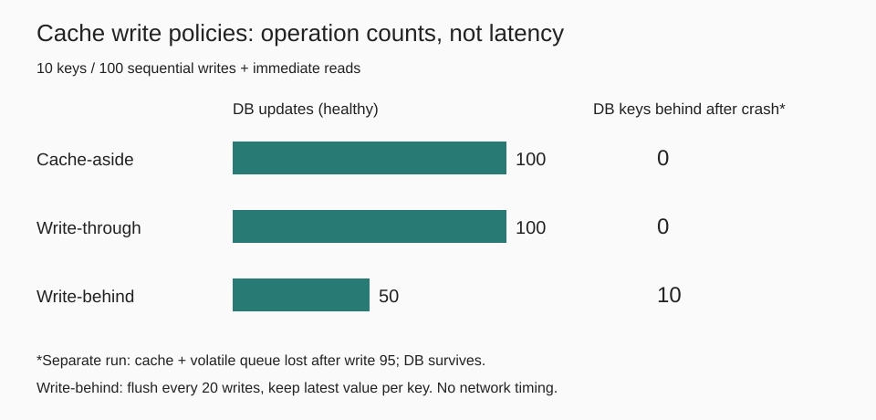

# 019. Cache-aside, write-through, write-behind

> 키 10개에 쓰기 100번을 보내고 매번 바로 읽었다. DB에 먼저 쓰고 캐시를 지우면 읽기 미스가 100번, 캐시까지 갱신하면 0번이었다. 메모리에 모아 20번마다 쓰면 DB UPDATE는 50번으로 줄었지만, 95번째 응답 직후 캐시와 휘발성 대기열을 버리면 최신 값 10개를 DB에서 복구할 수 없었다.

## 문제

캐시를 붙인 뒤 값이 바뀌면 어디부터 써야 할까? 읽기 미스만 줄이는 선택과, 응답한 값을 잃지 않는 선택은 다르다.

이 실험에서는 다음처럼 구현했다. 용어 자체가 장애 시 원자성까지 보장하는 것은 아니다.

- **Cache-aside**: 애플리케이션이 DB에 쓰고 커밋한 뒤 캐시를 지운다. 다음 읽기에서 DB를 조회해 채운다.
- **Write-through**: 쓰기 경로가 DB 커밋과 캐시 갱신을 마친 뒤 응답한다. 여기서는 DB를 먼저 쓴다.
- **Write-behind**: 캐시와 휘발성 대기열에 넣고 응답한다. 쓰기 20번마다 키별 마지막 값만 DB에 반영한다.

## 실행과 조건

```bash
python3 main.py
```

Python 3 표준 라이브러리만 사용한다. SQLite 메모리 DB와 Python dict로 동작 순서를 재현한다. 키 10개를 0으로 미리 채우고, 키를 순서대로 반복하며 매번 새 정숫값을 쓴 뒤 읽는다. 초기 적재와 검증용 SELECT는 아래 작업 수에서 제외했다. DB UPDATE 수는 반영한 행 수이고, 읽기 미스는 애플리케이션 읽기가 DB로 간 횟수다.

## 결과



### 정상 종료: 쓰기 100번 + 직후 읽기 100번

| 정책 | DB UPDATE | 읽기 미스 | 종료 후 최신 값이 없는 DB 키 |
|---|---:|---:|---:|
| Cache-aside | 100 | 100 | 0 |
| Write-through | 100 | 0 | 0 |
| Write-behind, 키별 병합 | 50 | 0 | 0 |

20번 쓰는 동안 각 키에 두 번 쓰므로, 마지막 값만 남기면 배치마다 UPDATE 10번이다. 배치 5회라 50번이다. 이것은 **덮어쓰기 가능한 상태값**을 병합한 결과다. 모든 이벤트를 보존해야 하는 결제·이력에는 그대로 적용하면 안 된다. 병합 없는 write-behind라면 이 작업의 UPDATE는 100번이다.

### 장애: 95번째 응답과 직후 읽기를 마친 뒤 캐시·대기열 유실

DB는 살아 있고 캐시 프로세스 메모리만 사라지는 상황을 메모리 초기화로 흉내 냈다. 실제 프로세스를 종료하거나 디스크 내구성을 시험한 것은 아니다.

| 정책 | 응답한 쓰기 | 반영한 DB UPDATE | 아직 DB에 반영되지 않은 쓰기 응답 | 최신 값이 없는 DB 키 |
|---|---:|---:|---:|---:|
| Cache-aside | 95 | 95 | 0 | 0 |
| Write-through | 95 | 95 | 0 | 0 |
| Write-behind, 키별 병합 | 95 | 40 | 15 | 10 |

80번째 쓰기까지 flush한 뒤 15번 더 응답했다. 그중 같은 키에 대한 쓰기가 병합되어 대기열에는 10개 키가 남는다. **미반영 응답 15번과 최신 값을 잃은 키 10개는 다른 지표**다. 캐시가 살아 있을 때는 바로 읽어도 모두 최신 값이어서, 읽기 성공만으로 DB 반영을 알 수 없었다.

### DB 먼저 쓰고 지워도 남는 경합

`stale_fill_race()`는 다음 순서를 고정해 재현한다.

1. 읽기 A가 캐시 미스로 DB의 0을 읽고, 캐시 채우기를 미룬다.
2. 쓰기 B가 DB를 1로 바꾸고 캐시를 지운다.
3. A가 뒤늦게 캐시에 0을 넣는다.
4. 다음 읽기는 캐시에서 0을 받지만 DB는 1이다.

따라서 DB 갱신 후 캐시 삭제도 강한 일관성의 보장은 아니다. 버전 검증·읽기 채우기와 쓰기의 동기화 같은 별도 설계가 필요하다. TTL은 오래된 값이 남는 시간을 줄일 수 있지만 경합 자체를 없애지는 않는다.

## 배운 점과 한계

- 쓰기 직후 읽는 이번 패턴에서는 write-through가 미스를 없앴다. 쓰기 후 다시 읽지 않는 값까지 캐시에 넣으면 캐시 공간만 쓸 수도 있다.
- Write-behind의 작업 감소는 비동기라는 이름이 아니라 **키별 병합**에서 나왔다. DB 반영 전 응답하므로 대기열 내구성·재처리·키별 순서·중복 처리가 중요하다.
- Write-through도 DB와 캐시를 하나의 원자적 트랜잭션으로 만든 것은 아니다. DB 커밋 후 캐시 갱신 실패 같은 부분 실패는 이 실험에서 다루지 않았다.
- 단일 클라이언트의 순차 실행이며, 경합은 별도 함수에서 순서를 고정했다. 네트워크, Redis, 실제 장애 복구, 지연 시간·처리량은 재지 않았다. **UPDATE가 절반이라고 두 배 빠르다는 뜻은 아니다.**

## 참고

- [Microsoft: Cache-Aside pattern](https://learn.microsoft.com/en-us/azure/architecture/patterns/cache-aside)
- [AWS: Database caching strategies](https://docs.aws.amazon.com/whitepapers/latest/database-caching-strategies-using-redis/caching-patterns.html)
