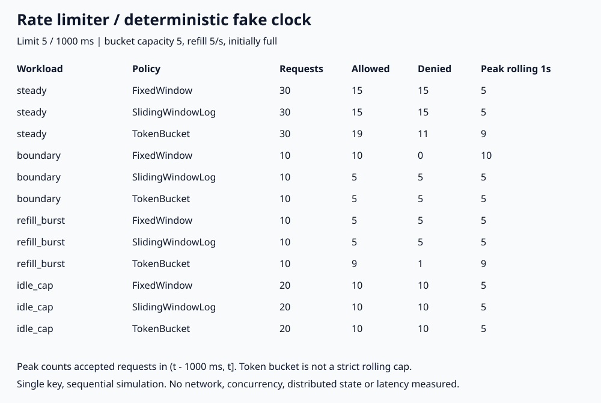

# 020. Rate limiter: fixed window, exact sliding log, token bucket

> 같은 ‘초당 5개’라도 허용하는 요청이 다르다. 999ms와 1000ms에 각각 5개를 보내면 fixed window는 10개를 모두 허용했다. 반대로 0ms에 5개, 800ms에 5개를 보내면 token bucket은 총 9개를 허용했다. Exact sliding log는 두 실험 모두 5개만 허용했다.

## 문제

API 요청 제한을 ‘초당 5개’라고만 정하면 창 경계와 burst 허용 여부가 빠진다. 고정된 1초마다 카운트를 초기화할 것인지, 어느 시점에서든 직전 1초에 허용한 요청을 세어야 하는지, 평소 사용하지 않은 여유를 burst로 허용할 것인지 먼저 정해야 한다.

## 실험

```bash
python3 main.py
# 검증한 실행 결과로 그림도 다시 생성하려면
python3 main.py --write-svg
```

Python 3 표준 라이브러리만 사용한다. 한 키에 대한 요청을 순서대로 처리하는 결정적 fake-clock 시뮬레이션이다. `sleep`이나 실제 시계는 사용하지 않는다. 모든 시간은 정수 ms이며, 같은 시각의 요청도 목록 순서대로 처리한다. 시나리오마다 정책 인스턴스를 새로 만든 뒤 **세 정책에 동일한 요청 목록**을 넣는다.

- **Fixed window**: `[k×1000, (k+1)×1000)` 창마다 허용 요청 5개. 1000ms부터 새 창이다.
- **Exact sliding window log**: 허용한 요청의 시각을 deque에 저장한다. 판단 시점 `t`에서 `t-1000` 이하를 제거하고 `(t-1000, t]`에 최대 5개만 허용한다. 거절한 시각은 저장하지 않는다. 가중 카운터 근사가 아니다.
- **Token bucket**: 용량 5토큰, 초당 5토큰 충전, 처음에는 가득 찬 상태다. 요청당 1토큰을 쓴다. 내부에서는 요청 비용을 1000 credit, ms당 충전을 5 credit으로 표현해 부동소수점 없이 부분 토큰을 보존한다. 거절할 때도 마지막 충전 시각을 갱신하며 남은 credit은 유지한다.

| 시나리오 | 요청 시각(ms) | 요청 수 |
|---|---|---:|
| steady | 0부터 2900까지 100 간격 | 30 |
| boundary | 999에 5개, 1000에 5개 | 10 |
| refill_burst | 0에 5개, 800에 5개 | 10 |
| idle_cap | 0에 10개, 10000에 10개 | 20 |

`max_rolling_1000ms`는 **허용된 요청만** 대상으로 모든 `(t-1000, t]` 구간에서 가장 큰 개수를 구한 값이다. 총 허용 수와 다른 지표다.

## 실제 결과와 환경

2026-10-31 실행: Python 3.13.12, macOS(Darwin 25.6.0), arm64. 아래는 실행 로그의 요청 수와 허용/거절 수다. 시간값은 가상 입력이며 실행 시간이나 응답 지연이 아니다.



| 시나리오 | 정책 | 요청 | 허용 | 거절 | 직전 1초 최대 허용 |
|---|---|---:|---:|---:|---:|
| steady | Fixed window | 30 | 15 | 15 | 5 |
| steady | Exact sliding log | 30 | 15 | 15 | 5 |
| steady | Token bucket | 30 | 19 | 11 | 9 |
| boundary | Fixed window | 10 | 10 | 0 | 10 |
| boundary | Exact sliding log | 10 | 5 | 5 | 5 |
| boundary | Token bucket | 10 | 5 | 5 | 5 |
| refill_burst | Fixed window | 10 | 5 | 5 | 5 |
| refill_burst | Exact sliding log | 10 | 5 | 5 | 5 |
| refill_burst | Token bucket | 10 | 9 | 1 | 9 |
| idle_cap | Fixed window | 20 | 10 | 10 | 5 |
| idle_cap | Exact sliding log | 20 | 10 | 10 | 5 |
| idle_cap | Token bucket | 20 | 10 | 10 | 5 |

- **경계 burst**: fixed window는 999ms에 이전 창 몫을, 1000ms에 새 창 몫을 허용했다. 두 시각은 1ms 차이인데 허용 요청은 10개다. 창별 5개라는 규칙은 지켰지만 rolling 1초 5개는 아니다.
- **충전 burst**: token bucket은 0ms의 5개로 비었다가 800ms 동안 4토큰을 충전했다. 따라서 다시 4개를 허용해 같은 rolling 1초 안에 총 9개가 들어갔다. 버그가 아니라 burst 예산과 지속 충전율을 함께 제한하는 정책이다. 용량 B와 충전율 r의 token bucket은 길이 Δ인 구간에 B+rΔ의 예산 상한을 갖는다. **충전율 5/s가 모든 rolling 1초에서 5개라는 뜻은 아니다.**
- **유휴 상한**: 10초를 쉬어도 token bucket 용량이 5라서 다음 동시 요청 10개 중 5개만 허용했다. 토큰이 무한히 쌓이지 않는다.
- **지속 요청**: 30개 중 token bucket은 19개를 허용했다. 초기 5토큰과 충전분을 쓴 결과이며, 이것을 처리량이나 성능 우위로 해석하면 안 된다.

### 회귀 검증

기본 실행에서 `regression_checks=26 PASS`, `workload_expectations=12 PASS`를 확인했다. 창 경계 초기화, 정확히 1000ms 된 로그의 만료, 거절이 만료를 늦추지 않는지, 토큰 199/200ms 경계, 작은 간격 충전의 누적 보존, 긴 유휴 뒤 용량 상한, 잘못된 설정·시간 역행 거부를 검사한다. 별도의 결정적 불규칙 입력에서도 exact log의 rolling 상한을 독립적인 전체 개수 세기로 검사하고 재실행 결과가 같은지 확인한다. `-O`는 assert를 끄므로 프로그램이 실행을 거부한다.

## 배운 점과 한계

- 달력처럼 정렬된 구간별 쿼터면 fixed window가 단순하다. 단, 창 전후의 몰림을 허용하는지 제품 요구사항에 적어야 한다.
- **어느 시점에서든 직전 1초에 최대 5개**여야 한다면 exact sliding log 같은 엄격한 정책이 맞다. 이 구현은 키당 최대 5개의 허용 시각을 보관한다. 일반화하면 제한 L에 대해 O(L) 메모리이며, 만료 제거는 요청당 최악 O(L), 전체적으로 amortized O(1)이다. Fixed window와 token bucket은 키당 O(1) 상태다. 이는 구현 구조 분석이지 메모리 벤치마크가 아니다.
- 일정 충전율을 유지하되 짧은 burst를 받아 주려면 token bucket이 맞다. 요청을 큐에 넣거나 일정 간격으로 내보내는 shaper는 아니며, 허용 즉시 처리한다.
- 단일 키·단일 프로세스·순차 실행이다. 다중 키 저장과 만료, 동시성, Redis·분산 노드 간 원자성, 실제 시계 오차와 장애, 네트워크, 실제 latency·처리량은 **측정하지 않았다**. 운영에서는 공유 상태의 확인·차감 원자성과 신뢰할 시계를 별도로 설계해야 한다. 실제 로컬 경과 시간에는 단조 시계를 고려하되, 노드 간 단조 시계 값을 그대로 공유할 수 있는 것은 아니다.

## 연결과 참고

- 면접 답변: [API-01](https://github.com/morningverse67-wq/backend-interview-lab/blob/main/api/rate-limiter.md)
- Velog 후속 글 후보: ‘초당 5개 제한인데 왜 1초에 9개가 허용될까?’
- [AWS API Gateway: token bucket의 rate와 burst 제한](https://docs.aws.amazon.com/apigateway/latest/developerguide/api-gateway-request-throttling.html)
