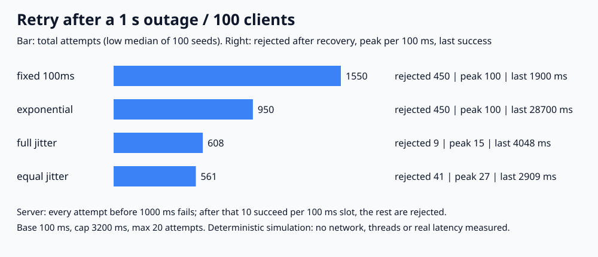

# 021. 재시도 + 지수 백오프 + jitter

> 1초 장애 뒤 클라이언트 100개가 동시에 재시도했다. 지수 백오프만 쓰면 100개가 계속 같은 시각에 몰려 복구된 서버가 450번을 거절했고, 마지막 성공은 28,700ms였다. 같은 백오프에 full jitter를 넣으면 거절은 9번(100개 seed의 low median), 마지막 성공은 4,048ms였다.

## 문제

장애가 나면 클라이언트는 재시도한다. 모두 같은 규칙으로 기다리면 장애 직후의 요청이 복구 시점에 다시 한꺼번에 도착한다. 간격만 늘리는 지수 백오프로 이 동기화가 풀리는지, jitter가 무엇을 바꾸는지 확인한다.

## 실험

```bash
python3 main.py
# 검증한 실행 결과로 그림도 다시 생성하려면
python3 main.py --write-svg
```

Python 3 표준 라이브러리만 사용한다. 정수 ms fake clock과 이벤트 큐로 돌리는 결정적 시뮬레이션이며 `sleep`, 네트워크, 스레드는 쓰지 않는다.

- 클라이언트 100개가 0ms에 동시에 요청한다.
- 서버는 1000ms 전에는 모든 요청을 실패시킨다. 1000ms부터는 100ms 구간마다 10개까지만 성공시키고 나머지는 거절한다. 같은 시각 요청은 클라이언트 번호 순서로 처리한다.
- 실패하면 정책에 따라 기다렸다가 다시 보낸다. 최대 20번(첫 요청 + 재시도 19번)까지 시도한다.
- 지연 정책(n = 0부터 센 재시도 번호, base 100ms, cap 3200ms):

| 정책 | 다음 시도까지 대기 |
|---|---|
| fixed 100ms | 항상 100ms |
| exponential | `min(3200, 100 × 2^n)` |
| full jitter | `0 ~ min(3200, 100 × 2^n)` 사이 정수 난수 |
| equal jitter | 위 값의 절반 + `0 ~ 절반` 사이 정수 난수 |

jitter 정책은 seed 1~100으로 100번 돌렸다. 각 지표의 low median(짝수 개일 때 가운데 두 값 중 작은 값, 실제 실행값)과 최소~최대를 적는다. 지표마다 따로 구한 값이라 한 행의 숫자가 같은 seed에서 나온 것은 아니다. fixed와 exponential은 난수를 쓰지 않아 모든 seed에서 같다.

## 실제 결과와 환경

2026-11-01 실행: Python 3.13.12, macOS(Darwin 25.6.0), arm64. 시간값은 가상 시계의 시각이며 실제 응답 시간이 아니다.



| 정책 | 성공 | 전체 시도 | 복구 후 거절 | 복구 후 100ms당 최대 시도 | 50번째 성공 | 마지막 성공 |
|---|---:|---:|---:|---:|---:|---:|
| fixed 100ms | 100 | 1,550 | 450 | 100 | 1,400ms | 1,900ms |
| exponential | 100 | 950 | 450 | 100 | 12,700ms | 28,700ms |
| full jitter | 100 | 608 (593~627) | 9 (0~21) | 15 (10~24) | 1,652ms (1,522~1,798) | 4,048ms (3,616~4,673) |
| equal jitter | 100 | 561 (557~568) | 41 (31~52) | 27 (22~35) | 2,001ms (1,890~2,134) | 2,909ms (2,708~5,723) |

‘복구 후 100ms당 최대 시도’ 기준은 처리 용량 10개다.

- **지수 백오프만 쓰면 묶음이 그대로 유지된다.** 100개 모두 0, 100, 300, 700, 1500ms에 같이 보냈다. 1500ms에 10개만 성공하고, 남은 90개는 다시 같은 시각(3100ms)에 몰렸다. 대기 시간이 cap 3200ms에 닿은 뒤에는 3200ms마다 10개씩만 빠져서 마지막 성공이 28,700ms였다. 간격은 늘었지만 동기화는 풀리지 않았다.
- **jitter는 같은 시각의 묶음을 흩는다.** full jitter는 복구 후 100ms당 최대 시도가 15번으로 용량(10)에 가까웠고, 복구 후 거절은 450번에서 9번으로 줄었다. 마지막 성공은 지수 백오프의 28,700ms보다 빨랐다(4,048ms).
- **equal jitter**는 최소 대기(절반)를 보장해 전체 시도가 가장 적었다(561번). 대신 흩어지는 폭이 절반이라 복구 후 거절 41번, 100ms당 최대 27번으로 full jitter보다 몰렸다.
- **fixed 100ms가 가장 빨리 끝났다(1,900ms).** 이 모델의 서버는 요청이 몰려도 느려지지 않고 매 구간 10개씩 처리하기 때문이다. 그 대가로 시도 1,550번, 복구 직후 구간에는 용량의 10배인 100번이 몰렸다. 과부하에서 서버가 느려지거나 다시 죽는 효과는 넣지 않았으므로 이 속도를 그대로 믿으면 안 된다.

### 회귀 검증

기본 실행에서 `regression_checks=55 PASS`를 확인했다. 지수 대기 값과 cap, full/equal jitter의 범위, fixed·exponential의 손으로 계산한 결과(시도 1,550/950번, 마지막 성공 1,900/28,700ms, 거절 450번), 최대 시도 수 경계(4번이면 0개, 5번이면 10개 성공), 모든 클라이언트가 성공 또는 포기 중 하나인지, 구간별 성공이 용량을 넘지 않는지, 장애 중 성공이 없는지, 같은 seed 재실행 결과가 같은지, 잘못된 설정 거부를 검사한다. `-O`는 assert를 끄므로 프로그램이 실행을 거부한다.

## 배운 점과 한계

- 재시도 간격을 늘리는 것과 재시도 시각을 흩는 것은 다른 문제다. 같은 순간에 실패한 클라이언트가 많으면 지수 백오프에도 jitter가 필요하다.
- 빠른 고정 재시도는 서버가 과부하에서도 멀쩡하다는 가정에서만 빠르다. 이번 결과에서도 복구 직후 용량의 10배가 몰렸다.
- full jitter와 equal jitter 중 무엇이 낫다고 이 실험 하나로 정할 수는 없다. 이번 조건에서는 full jitter가 복구 후 몰림이 적었고, equal jitter가 전체 시도가 적었다.
- 단일 서버 용량 모델이다. 과부하 시 처리량 저하, 타임아웃, 네트워크 지연, 재시도 예산·circuit breaker, 멱등성(같은 요청을 여러 번 보내도 안전한지), `Retry-After` 응답은 다루지 않았다. 재시도는 멱등한 요청이나 멱등성 키를 쓰는 요청에만 해야 한다([lab 014](../014-idempotency-key)).

## 연결과 참고

- 면접 답변: [API-02](https://github.com/morningverse67-wq/backend-interview-lab/blob/main/api/retry-backoff-jitter.md)
- [AWS Architecture Blog: Exponential Backoff And Jitter](https://aws.amazon.com/blogs/architecture/exponential-backoff-and-jitter/)
- [Google Cloud Storage: Retry strategy](https://cloud.google.com/storage/docs/retry-strategy)
