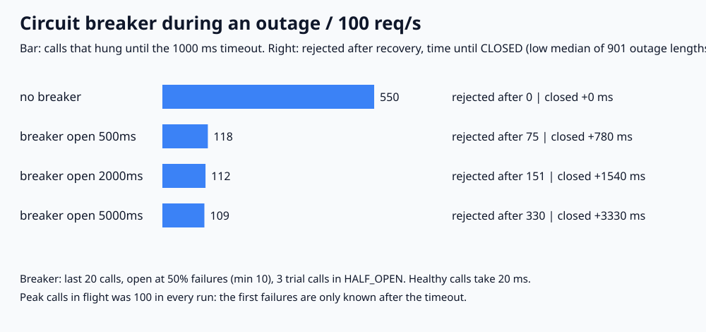

# 022. Circuit breaker 상태 전이

> 외부 서비스가 멈춘 동안 1초 타임아웃까지 매달린 호출은, breaker가 없으면 장애 시간만큼 계속 늘었다(장애 길이 901가지의 low median 550번). breaker를 달면 open 시간과 관계없이 109~118번으로 줄었다. 대신 서비스가 살아난 뒤에도 거절이 이어졌고, open 시간을 길게 잡을수록 다시 닫히기까지 오래 걸렸다(500ms 780ms, 5000ms 3,330ms).

## 문제

외부 API가 응답하지 않으면 호출마다 타임아웃까지 기다린다. 그동안 스레드와 커넥션이 묶인다. circuit breaker는 실패가 몰리면 호출을 잠시 막고(OPEN), 시간이 지나면 몇 개만 시험해 보고(HALF_OPEN), 성공하면 다시 연다(CLOSED). 이 상태 전이가 실제로 무엇을 줄이고 무엇을 대가로 내는지 확인한다.

## 실험

```bash
python3 main.py
# 검증한 실행 결과로 그림도 다시 생성하려면
python3 main.py --write-svg
```

Python 3 표준 라이브러리만 사용한다. 정수 ms fake clock으로 돌리는 결정적 시뮬레이션이며 `sleep`, 네트워크, 스레드는 쓰지 않는다.

- 요청은 10ms마다 1개(초당 100개), 0~19,990ms 동안 2,000개다.
- 외부 서비스는 정상일 때 20ms에 성공한다. 장애 구간에 보낸 호출은 응답이 없어 타임아웃 1000ms 뒤 실패한다.
- breaker 설정(모든 정책 공통): 최근 완료된 호출 20개 중 실패가 50% 이상이면 OPEN(최소 10개). OPEN 시간이 지난 뒤 첫 요청에서 HALF_OPEN으로 바뀌고, 시험 호출 3개를 보낸다. 3개가 모두 성공하면 CLOSED, 하나라도 실패하면 다시 OPEN이다. 시험 호출이 진행 중일 때 들어온 나머지 요청은 거절한다.
- 상태가 바뀌기 전에 보낸 호출의 결과는 새 상태에 반영하지 않는다(예: OPEN 전에 보낸 호출이 늦게 실패해도 HALF_OPEN 판정에 쓰지 않음). 같은 시각이면 호출 완료를 먼저 처리한 뒤 새 요청을 받는다. 마지막 요청 뒤에 끝나는 호출은 결과 수만 센다.
- 비교: breaker 없음, OPEN 시간 500ms / 2000ms / 5000ms.

장애 시작은 1000ms로 고정하고, 끝나는 시각을 2,000~11,000ms까지 10ms씩 바꿔 901번 돌렸다. 장애가 끝나는 순간이 시험 호출 직전인지 직후인지에 따라 결과가 크게 달라지기 때문이다. 각 지표의 low median(짝수 개일 때 가운데 두 값 중 작은 값, 실제 실행값)과 최소~최대를 적는다. 지표마다 따로 구한 값이라 한 행의 숫자가 같은 실행에서 나온 것은 아니다.

## 실제 결과와 환경

2026-11-02 실행: Python 3.13.12, macOS(Darwin 25.6.0), arm64. 시간값은 가상 시계의 시각이며 실제 응답 시간이 아니다.



| 정책 | 타임아웃까지 기다린 호출 | 복구 후 거절 | 복구 후 CLOSED까지 | 동시에 매달린 호출 최대 |
|---|---:|---:|---:|---:|
| breaker 없음 | 550 (100~1,000) | 0 | 0ms | 100 |
| OPEN 500ms | 118 (100~127) | 75 (1~148) | 780ms (40~1,530) | 100 |
| OPEN 2000ms | 112 (100~118) | 151 (1~298) | 1,540ms (40~3,030) | 100 |
| OPEN 5000ms | 109 (100~112) | 330 (1~598) | 3,330ms (40~6,030) | 100 |

‘복구 후 거절’은 외부 서비스가 이미 정상인데 breaker가 막은 요청 수다. breaker 없음의 타임아웃 수는 장애 길이에 비례한다(1초면 100번, 10초면 1,000번).

장애 1000~6000ms 한 번의 상태 전이(OPEN 2000ms):

| 시각 | 상태 | 이유 |
|---:|---|---|
| 2,090ms | OPEN | 1,000ms부터 보낸 호출이 1초 뒤부터 실패로 돌아오고, 10번째 실패(1,090ms에 보낸 호출)에서 최근 20개 중 50% |
| 4,090ms | HALF_OPEN | 시험 호출 3개를 보냈지만 아직 장애 중 |
| 5,090ms | OPEN | 첫 시험 호출이 1초 타임아웃으로 실패 |
| 7,090ms | HALF_OPEN | 장애는 6,000ms에 끝났지만 OPEN이라 그동안 거절 |
| 7,130ms | CLOSED | 시험 호출 3개 모두 성공 |

이 한 번의 장애에서 breaker 없음은 타임아웃 500번(기다린 시간 합계 500,000ms), OPEN 2000ms는 112번(112,000ms)이었다. 대신 6,000~7,130ms 사이 110개를 서비스가 정상인데도 거절했다. 이 장애 길이에서는 세 OPEN 시간 모두 7,130ms에 닫혔다. 6,000ms 직전에 보낸 시험 호출이 모두 1초 뒤 실패했고, 그다음 시험이 마침 같은 시각(7,090ms)에 왔기 때문이다. 그래서 표는 장애 길이를 바꿔 가며 잰 값으로 적었다.

- **breaker는 타임아웃을 ‘첫 물결’ 정도로 묶는다.** 장애가 10초여도 breaker가 있으면 타임아웃 호출은 최대 127번이었다. 열리기 전에 보낸 약 109번과, HALF_OPEN 때 보낸 시험 호출 3개씩이다.
- **첫 물결은 막지 못한다.** 실패는 1초 타임아웃이 지나야 알 수 있어서, 모든 정책에서 동시에 매달린 호출이 100개(초당 100개 × 1초)까지 갔다. 이 수를 줄이는 것은 breaker가 아니라 타임아웃 길이다.
- **OPEN 시간은 트레이드오프다.** 짧으면 장애 중 시험 호출이 늘어(118번) 대신 빨리 닫히고(780ms), 길면 시험 호출은 줄지만(109번) 정상인 서비스를 오래 막는다(복구 후 거절 330개, 3,330ms).
- **드문 실패로는 열리지 않는다.** 장애 없이 10번째 호출마다 실패시키면 실패율 10%라 한 번도 열리지 않았다(회귀 검증에 포함).

### 회귀 검증

기본 실행에서 `regression_checks=100 PASS`를 확인했다. 손으로 계산한 장애 1000~6000ms 결과(breaker 없음 타임아웃 500번·동시 100개, OPEN 2000ms의 위 상태 전이 5개·타임아웃 112번·거절 498개·복구 후 거절 110개), 10%·50% 간헐 실패에서 열리는지, 장애가 없으면 거절이 0인지, 모든 정책과 장애 길이 4가지에서 요청 수 보존(호출 + 거절 = 2,000)과 타임아웃 = 장애 중 호출 수, breaker가 결국 다시 닫히는지, 같은 설정 재실행 결과가 같은지, 잘못된 설정 거부를 검사한다. `-O`는 assert를 끄므로 프로그램이 실행을 거부한다.

## 배운 점과 한계

- breaker가 줄이는 것은 장애가 길어질수록 쌓이는 타임아웃 대기다. 처음 실패를 알아차리기까지의 피해는 타임아웃 길이와 요청량이 정한다.
- OPEN 시간이 정답인 값은 없다. 이번 조건에서는 짧을수록 장애 중 시험 호출이 조금 늘고, 복구 후 거절은 크게 줄었다. 시험 호출 하나가 실패를 알리는 데도 타임아웃만큼 걸린다는 점이 같이 작동한다.
- 거절된 요청에 무엇을 돌려줄지(캐시 값, 기본값, 빠른 오류)는 이 실험에서 다루지 않았다.
- 단일 클라이언트 프로세스, 고정 요청량, 응답 없음(타임아웃)만 있는 장애 모델이다. 느린 응답 비율(slow call), 시간 기반 window, 여러 인스턴스가 각자 breaker를 두는 경우, 재시도와의 조합([lab 021](../021-retry-backoff-jitter))은 다루지 않았다.

## 연결과 참고

- 면접 답변: [API-03](https://github.com/morningverse67-wq/backend-interview-lab/blob/main/api/circuit-breaker.md)
- [Martin Fowler: CircuitBreaker](https://martinfowler.com/bliki/CircuitBreaker.html)
- [Resilience4j: CircuitBreaker](https://resilience4j.readme.io/docs/circuitbreaker)
- [Microsoft Azure Architecture Center: Circuit Breaker pattern](https://learn.microsoft.com/en-us/azure/architecture/patterns/circuit-breaker)
