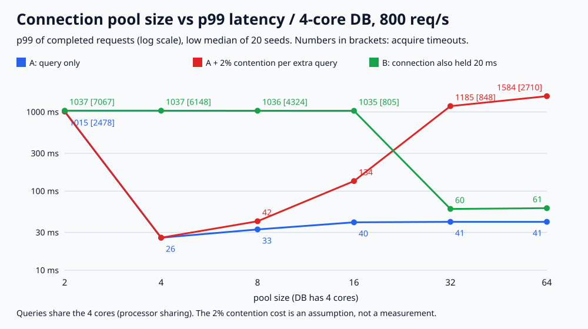

# 023. 커넥션 풀 크기와 대기 시간

> 4코어 DB 앞에서 풀 크기만 2~64로 바꿨다(초당 800개, 쿼리당 평균 4ms). 2개면 처리량이 모자라 요청 2,478개가 커넥션을 못 받고 1초 뒤 포기했다. 4개부터는 포기가 0개였고, 그 위로는 기다리는 곳만 풀에서 DB로 옮겨 갔다(p99 25.80ms → 40.86ms). 쿼리가 코어보다 많을 때 2%씩 느려진다고 가정하면 32개에서 다시 848개가 포기했다. 쿼리 뒤에 커넥션을 20ms 더 쥐면 16개로도 805개가 포기했다.

## 문제

커넥션 풀이 작으면 요청이 커넥션을 기다리고, 크면 DB에 동시에 들어가는 쿼리가 늘어난다. 풀을 키우면 대기가 사라지는지, 아니면 대기하는 장소만 바뀌는지 확인한다. 커넥션을 쥐고 있는 시간이 길어지면 필요한 풀 크기가 어떻게 바뀌는지도 본다.

## 실험

```bash
python3 main.py
# 검증한 실행 결과로 그림도 다시 생성하려면
python3 main.py --write-svg
```

Python 3 표준 라이브러리만 사용한다. 가상 시계로 돌리는 이벤트 시뮬레이션이며 `sleep`, 실제 DB, 스레드는 쓰지 않는다.

- 요청은 초당 800개 포아송 도착, 10초 동안이다(seed마다 7,818~8,142개, low median 7,984개).
- 쿼리 하나는 DB CPU를 평균 4ms(지수분포) 쓴다. DB 코어는 4개라 평균 사용률은 800 × 4ms ÷ 4코어 = 80%다.
- DB는 실행 중인 쿼리들이 코어를 나눠 쓴다(processor sharing). 쿼리가 4개 이하면 각자 제 속도, 8개면 각자 절반 속도다.
- 요청은 빈 커넥션을 FIFO로 기다리고, 1,000ms 안에 못 받으면 포기한다(acquire timeout).
- 같은 seed의 요청 흐름(도착 시각, 쿼리 작업량)을 모든 풀 크기에 똑같이 넣는다.
- 시나리오
  - **A**: 쿼리만 하고 바로 반납한다.
  - **A + 경합 2%**: A와 같지만, 실행 중인 쿼리가 코어 수보다 하나 많을 때마다 모든 쿼리가 2%씩 더 느려진다고 **가정**한다(문맥 전환, 락·버퍼 경합을 흉내 낸 값이며 실측이 아니다).
  - **B**: 쿼리 뒤에 커넥션을 20ms 더 쥔다. 트랜잭션 안에서 외부 API를 부르는 경우를 흉내 냈다.

seed 1~20을 돌려 지표마다 low median(짝수 개일 때 가운데 두 값 중 작은 값, 실제 실행값)과 최소~최대를 적는다. 지표마다 따로 구한 값이라 한 행의 숫자가 같은 실행에서 나온 것은 아니다. 지연 시간은 끝까지 처리된 요청만으로 구한 nearest-rank 백분위다.

## 실제 결과와 환경

2026-11-03 실행: Python 3.13.12, macOS(Darwin 25.6.0), arm64. 시간값은 가상 시계의 값이며 실제 응답 시간이 아니다.



**A: 쿼리만**

| 풀 | p50 | p99 | 풀 대기 p99 | DB 안 p99 | 포기 | DB 동시 쿼리 최대 |
|---:|---:|---:|---:|---:|---:|---:|
| 2 | 999.06ms | 1,014.87ms | 999.96ms | 18.53ms | 2,478 (2,291~2,734) | 2 |
| 4 | 5.46ms | 25.80ms (21.50~38.43) | 19.61ms | 18.39ms | 0 | 4 |
| 8 | 4.60ms | 32.78ms (28.15~43.43) | 14.89ms | 28.69ms | 0 | 8 |
| 16 | 4.13ms | 40.33ms (30.23~51.15) | 5.31ms | 39.48ms | 0 | 16 |
| 32 | 4.08ms | 40.86ms (30.23~54.90) | 0.00ms | 40.86ms | 0 | 29 (20~32) |
| 64 | 4.08ms | 40.86ms (30.23~55.76) | 0.00ms | 40.86ms | 0 | 29 (20~54) |

**A + 경합 2%(가정)**: 풀 2·4는 동시 쿼리가 코어 수를 넘지 않아 A와 같다.

| 풀 | p50 | p99 | 풀 대기 p99 | DB 안 p99 | 포기 |
|---:|---:|---:|---:|---:|---:|
| 8 | 6.14ms | 41.63ms (33.35~66.05) | 24.21ms | 33.30ms | 0 |
| 16 | 26.54ms (7.44~160.65) | 133.81ms (77.13~281.91) | 97.53ms | 81.40ms | 0 |
| 32 | 922.80ms | 1,185.28ms | 999.86ms | 223.06ms | 848 (499~1,120) |
| 64 | 1,045.94ms | 1,583.54ms | 999.95ms | 623.18ms | 2,710 (2,144~3,018) |

**B: 쿼리 뒤 20ms 더 쥠**

| 풀 | p50 | p99 | 포기 | 평균 사용 중 커넥션 | 커넥션 1회 점유 평균 |
|---:|---:|---:|---:|---:|---:|
| 2 | 1,021.20ms | 1,036.80ms | 7,067 (6,911~7,230) | 2.00 | 24.02ms |
| 4 | 1,021.05ms | 1,036.85ms | 6,148 (5,993~6,317) | 4.00 | 24.00ms |
| 8 | 1,020.53ms | 1,036.29ms | 4,324 (4,153~4,485) | 7.99 | 24.02ms |
| 16 | 1,006.01ms | 1,034.54ms | 805 (650~1,011) | 15.96 | 24.54ms |
| 32 | 24.20ms | 59.51ms (50.17~68.48) | 0 | 21.35 | 26.71ms |
| 64 | 24.08ms | 60.86ms (50.23~74.65) | 0 | 21.54 | 26.92ms |

- **풀이 처리량보다 작으면 대기가 끝없이 쌓인다.** 풀 2개는 동시에 2코어만 쓰므로 초당 약 500개가 한계다. 초당 800개가 들어오니 풀 대기가 1초까지 차고 2,478개가 포기했다.
- **처리량을 넘긴 뒤로는 기다리는 곳만 바뀐다.** A에서 풀 4개는 풀 대기 p99 19.61ms + DB 안 18.39ms, 풀 64개는 풀 대기 0ms + DB 안 40.86ms였다. 풀을 키우면 p50은 5.46 → 4.08ms로 줄었지만 p99는 25.80 → 40.86ms로 늘었다. 줄을 풀에서 서면 들어간 쿼리는 제 속도로 돌고, 모두 DB에 들어가면 긴 쿼리가 다른 쿼리와 코어를 나눠 쓰며 늘어난다. 풀 32·64개에서도 동시 쿼리는 최대 29개까지만 갔다(seed 중앙값).
- **경합 비용이 있으면 큰 풀은 무너진다.** 2% 가정에서 동시 쿼리 16개는 코어 3.23개만큼, 17개는 3.17개만큼 일한다. 필요한 양은 800 × 4ms = 3.2코어라 17개를 넘기면 들어오는 일을 못 따라간다. 풀 16개는 버텼지만 p99 133.81ms였고, 32개부터는 포기가 생겼다. 풀이 이 문턱 아래(4~8개)면 같은 가정에서도 p99 25.80~41.63ms였다. 2%라는 값은 가정이라 실제 DB에서 문턱이 어디인지는 이 실험이 말해 주지 않는다.
- **필요한 풀 크기는 커넥션을 쥐는 시간이 정한다.** B에서 커넥션 1회 점유는 평균 26.92ms였고, 초당 800 × 26.92ms = 21.5개가 평균 사용 중 커넥션(21.54개)과 맞았다(Little의 법칙). 그래서 쿼리만 하면 충분했던 16개에서 805개가 포기했다. DB는 한가했다(DB 동시 쿼리 최대 10~13개). 이때 고칠 곳은 풀 크기보다 트랜잭션 안의 외부 호출이다.

### 회귀 검증

기본 실행에서 `regression_checks=39 PASS`를 확인했다. 손으로 계산한 경우(요청 1개 4ms, 풀 1개에 요청 2개면 두 번째가 4ms 대기, 1코어를 쿼리 2개가 나누면 둘 다 8ms, 50% 경합이면 12ms, 2ms·6ms 쿼리는 4ms·8ms에 끝남, 20ms 점유면 두 번째가 48ms, 1,000ms 대기 후 포기, 정확히 마감 시각에 커넥션을 받으면 처리), 풀 크기를 넘는 동시 쿼리가 없는지, 요청 수 보존(처리 + 포기 = 전체), 풀 대기 ≤ 1,000ms, 코어 이하 풀은 경합 가정과 무관한지, 2% 경합에서 16·17개 처리 능력 경계, 같은 seed 재현성, 잘못된 입력 거부를 검사한다. `-O`는 assert를 끄므로 프로그램이 실행을 거부한다.

## 배운 점과 한계

- 풀 크기는 DB 처리 능력을 늘리지 않는다. 처리 능력에 못 미치면 요청이 포기하고, 넘기면 대기가 풀에서 DB로 옮겨 갈 뿐이다.
- 풀은 DB에 들어가는 동시 쿼리 수의 상한이기도 하다. 동시 실행이 늘수록 느려지는 DB라면 풀을 작게 두는 것이 보호 장치가 된다. HikariCP 문서의 출발점 공식(코어 수 × 2 + 디스크 수)도 이 방향이다.
- 필요한 커넥션 수는 대략 초당 요청 수 × 커넥션 1회 점유 시간이다. 점유 시간이 길어지면 풀을 키우기 전에 그 시간을 줄일 수 있는지 먼저 본다.
- CPU만 쓰는 쿼리, 고정된 도착률, 한 애플리케이션 인스턴스만 다룬 모델이다. 디스크·네트워크 I/O 대기(이때는 코어 수보다 많은 동시 쿼리가 도움이 될 수 있다), 여러 인스턴스가 각자 풀을 두는 경우, 커넥션 생성 비용, 실제 DB의 경합 곡선은 다루지 않았다. HikariCP 기본 대기 시간은 30초이고, 이 실험은 1초로 줄여서 봤다.

## 연결과 참고

- 면접 답변: [API-04](https://github.com/morningverse67-wq/backend-interview-lab/blob/main/api/connection-pool-size.md)
- 앞 실험: 장애 중 매달린 호출 수는 [lab 022](../022-circuit-breaker)
- [HikariCP Wiki: About Pool Sizing](https://github.com/brettwooldridge/HikariCP/wiki/About-Pool-Sizing)
- [HikariCP README: Configuration (maximumPoolSize, connectionTimeout)](https://github.com/brettwooldridge/HikariCP)
- [PostgreSQL Wiki: Number Of Database Connections](https://wiki.postgresql.org/wiki/Number_Of_Database_Connections)
