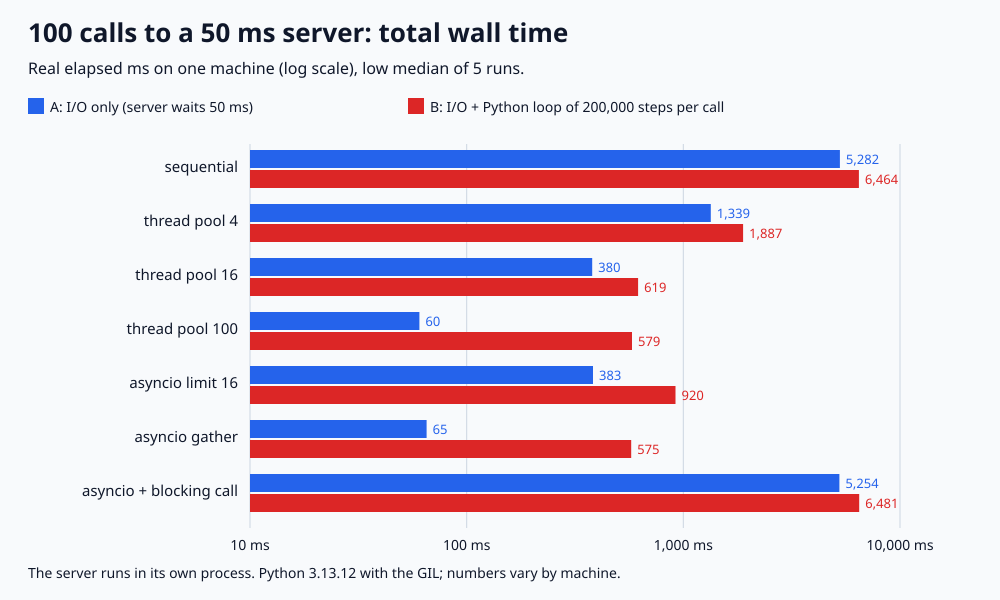

# 024. 동기 vs 스레드 풀 vs asyncio로 I/O 작업 처리

> 50ms 걸리는 로컬 서버에 100번 호출했다. 하나씩 부르면 5,281.5ms, 스레드 100개는 60.5ms, asyncio `gather`는 65.3ms였다. 스레드 16개(379.7ms)와 동시 16개로 묶은 asyncio(383.1ms)도 거의 같았다. 속도를 정한 건 도구가 아니라 동시에 기다린 호출 수였다. `async def` 안에서 블로킹 호출을 쓰면 5,254.4ms로 순차와 같았다. 호출마다 Python 반복문(20만 번)을 붙이면 스레드 100개도 579.2ms로, 클라이언트 CPU 시간(592.5ms)만큼 걸렸다.

## 문제

외부 API나 DB처럼 응답을 기다리는 작업이 많을 때 순차 호출, 스레드 풀, asyncio 중 무엇이 얼마나 빠른지 잰다. asyncio가 스레드보다 빠른지, `async def`로 바꾸기만 하면 되는지, 기다림 사이에 CPU 작업이 끼면 어떻게 되는지 확인한다.

## 실험

```bash
python3 main.py
# 검증한 실행 결과로 그림도 다시 생성하려면
python3 main.py --write-svg
```

Python 3 표준 라이브러리만 사용한다. 실제 시계로 잰다(전체 약 2분 30초).

- 서버: 같은 스크립트를 별도 프로세스로 띄운 asyncio HTTP 서버다(127.0.0.1). `GET /<i>`를 받으면 50ms 기다렸다가 본문 `<i>`로 답한다. 외부 API 응답 대기를 흉내 냈다. 서버는 동시에 처리 중인 요청 수의 최댓값도 센다.
- 클라이언트: 호출 100번. 순차와 스레드 풀은 블로킹 소켓, asyncio는 `asyncio.open_connection`을 쓰고 보내는 바이트는 같다. 호출마다 새 연결을 연다(`Connection: close`).
- 방식
  - **순차**: `for` 문으로 하나씩
  - **스레드 풀 4 / 16 / 100**: `ThreadPoolExecutor(max_workers=n)`
  - **asyncio 동시 16**: `asyncio.Semaphore(16)`로 동시 호출 수를 제한
  - **asyncio gather**: 100개를 한꺼번에
  - **asyncio + 블로킹 호출**: `async def` 안에서 블로킹 소켓 함수를 그대로 부르는 실수
- 시나리오
  - **A**: 응답만 받는다.
  - **B**: 응답을 받은 뒤 Python 반복문 20만 번(`total += i * i % 7`)을 돈다. 응답 파싱이나 계산처럼 CPU를 쓰는 일을 흉내 냈다.

방식마다 5번 돌려 low median(가운데 값, 실제 실행값)과 최소~최대를 적는다. 매 실행에서 응답 100개가 각자 자기 요청의 답(`/i` → `i`)인지 확인한다. 하한은 `ceil(100 ÷ 동시 호출 수) × 50ms`다.

## 실제 결과와 환경

2026-11-04 실행: Python 3.13.12(GIL 켜짐), macOS(Darwin 25.6.0), arm64, 로컬 루프백. 다른 컴퓨터에서는 수치가 달라진다.



**A: 응답만 받기**

| 방식 | 전체 시간 | 하한 | 서버가 본 동시 요청 최대 | 클라이언트 CPU |
|---|---:|---:|---:|---:|
| 순차 | 5,281.5ms (5,276.7~5,282.5) | 5,000ms | 1 | 31.3ms |
| 스레드 풀 4 | 1,339.3ms (1,331.4~1,341.5) | 1,250ms | 4 | 33.4ms |
| 스레드 풀 16 | 379.7ms (372.3~381.0) | 350ms | 16 | 26.9ms |
| 스레드 풀 100 | 60.5ms (60.3~61.1) | 50ms | 100 | 22.7ms |
| asyncio 동시 16 | 383.1ms (380.5~388.0) | 350ms | 16 | 25.8ms |
| asyncio gather | 65.3ms (64.6~69.9) | 50ms | 100 | 13.4ms |
| asyncio + 블로킹 호출 | 5,254.4ms (5,219.4~5,283.0) | 5,000ms | 1 | 24.7ms |

**B: 응답 + Python 반복문 20만 번**

| 방식 | 전체 시간 | 서버가 본 동시 요청 최대 | 클라이언트 CPU |
|---|---:|---:|---:|
| 순차 | 6,464.4ms (6,352.8~6,782.5) | 1 | 1,205.3ms (1,091.7~1,530.9) |
| 스레드 풀 4 | 1,886.8ms (1,856.9~1,924.1) | 4 | 676.2ms |
| 스레드 풀 16 | 618.6ms (601.6~645.3) | 16 | 533.2ms |
| 스레드 풀 100 | 579.2ms (572.9~595.5) | 100 | 592.5ms |
| asyncio 동시 16 | 920.0ms (913.6~921.1) | 16 | 553.9ms |
| asyncio gather | 574.8ms (572.0~577.2) | 100 | 522.4ms |
| asyncio + 블로킹 호출 | 6,480.6ms (6,377.8~6,648.9) | 1 | 1,244.2ms |

클라이언트 CPU는 `time.process_time()` 차이로, 클라이언트 프로세스의 모든 스레드가 쓴 CPU 시간을 더한 값이다.

- **기다리는 일은 동시에 몇 개를 기다리느냐가 시간을 정한다.** 동시 호출 수가 1, 4, 16, 100일 때 전체 시간은 하한(5,000, 1,250, 350, 50ms)보다 6~21% 길었다. 스레드 16개와 asyncio 동시 16은 379.7ms와 383.1ms, 스레드 100개와 gather는 60.5ms와 65.3ms로 같은 동시 수끼리 비슷했다. 100개를 동시에 기다리는 데 쓴 CPU는 asyncio가 13.4ms, 스레드가 22.7ms였다.
- **`async def`로 감싸기만 하면 빨라지지 않는다.** 코루틴 안에서 블로킹 소켓을 부르면 그 호출이 끝날 때까지 이벤트 루프가 멈춘다. 서버가 본 동시 요청은 1개, 전체 시간은 5,254.4ms로 순차(5,281.5ms)와 같았다.
- **CPU 작업은 스레드를 늘려도 나눠지지 않았다.** B에서 스레드 100개는 579.2ms였고 그동안 클라이언트 CPU는 592.5ms였다. GIL 때문에 Python 코드는 한 번에 한 스레드만 돌아서, 기다림이 다 겹친 뒤에는 CPU 시간의 합이 전체 시간이 됐다. 단일 스레드인 gather(574.8ms)와 차이가 없었다.
- **asyncio에서는 CPU 작업이 다음 요청도 막았다.** 동시 16에서 스레드는 618.6ms, asyncio는 920.0ms였다. asyncio는 한 코루틴이 반복문을 도는 동안 루프가 멈춰 다음 요청을 보내지 못한다. 16개 응답이 함께 도착하면 16개 반복문을 다 돈 뒤에야 다음 16개를 보낸다. 스레드는 한 스레드가 계산하는 동안 다른 스레드가 소켓을 기다리거나 다음 요청을 보낼 수 있었다.
- 같은 반복문인데 순차일 때 클라이언트 CPU가 1,205.3ms로, 몰아서 돌린 gather(522.4ms)의 2.3배였다. 50ms씩 쉬었다가 계산하는 패턴에서 CPU 클럭이나 코어 배치가 달라졌을 가능성이 있지만, 이 실험은 원인을 측정하지 않았다.

### 회귀 검증

기본 실행에서 `regression_checks=26 PASS`를 확인했다. 호출 1번이 50ms 이상 걸리고 서버가 동시 요청 1개를 보는지(블로킹·asyncio 각각), 8번 호출에서 방식마다 `ceil(8 ÷ 동시 수) × 50ms`보다 빠르지 않은지, 서버가 본 동시 요청이 제한을 넘지 않는지(순차·블로킹은 정확히 1), 30개를 동시에 보내 순서가 섞여 끝나도 응답이 자기 요청과 맞는지, 잘못된 입력(스레드 0개, 동시 0개)을 거부하는지 검사한다. 본 실험에서도 매 실행의 응답 100개 일치, 하한 이상, 동시 요청 ≤ 제한을 assert로 확인한다. `-O`는 assert를 끄므로 프로그램이 실행을 거부한다.

## 배운 점과 한계

- I/O 대기가 대부분인 작업에서는 스레드 풀과 asyncio 모두 기다림을 겹쳐서 빨라진다. 같은 동시 수라면 시간은 비슷했고, 차이는 동시 연결 하나에 드는 비용(CPU, 메모리)에서 난다.
- asyncio는 호출 경로 전체가 논블로킹이어야 한다. 블로킹 라이브러리를 쓴다면 `asyncio.to_thread`나 executor로 넘기거나 비동기 클라이언트로 바꾼다.
- 동시 수 제한(스레드 풀 크기, Semaphore)은 상대 서버를 보호하는 장치이기도 하다. 무제한 `gather`는 상대에게 한꺼번에 100개를 보냈다.
- CPU를 쓰는 부분은 스레드와 asyncio 모두 빨라지지 않았다(GIL). 이 부분이 크면 프로세스 풀이나 별도 작업자로 나누는 것을 검토한다. 프로세스 풀과 free-threaded 빌드(GIL 없음)는 이 실험에서 재지 않았다.
- 로컬 루프백, 응답 지연 고정 50ms, 호출마다 새 연결, 100번만 다룬 실험이다. 실제 네트워크 지연과 변동, 커넥션 재사용(keep-alive), 수천 개 동시 연결에서의 스레드 메모리, 타임아웃은 다루지 않았다. 외부 호출 타임아웃은 다음 실험 주제다.

## 연결과 참고

- 면접 답변: [API-05](https://github.com/morningverse67-wq/backend-interview-lab/blob/main/api/sync-threadpool-asyncio.md)
- 앞 실험: 커넥션을 쥐는 시간과 풀 크기는 [lab 023](../023-connection-pool-size)
- [Python 문서: asyncio로 개발하기 (블로킹 코드 실행, 동시성과 멀티스레딩)](https://docs.python.org/3/library/asyncio-dev.html)
- [Python 문서: concurrent.futures.ThreadPoolExecutor](https://docs.python.org/3/library/concurrent.futures.html#threadpoolexecutor)
- [Python 문서: asyncio.to_thread](https://docs.python.org/3/library/asyncio-task.html#asyncio.to_thread)
