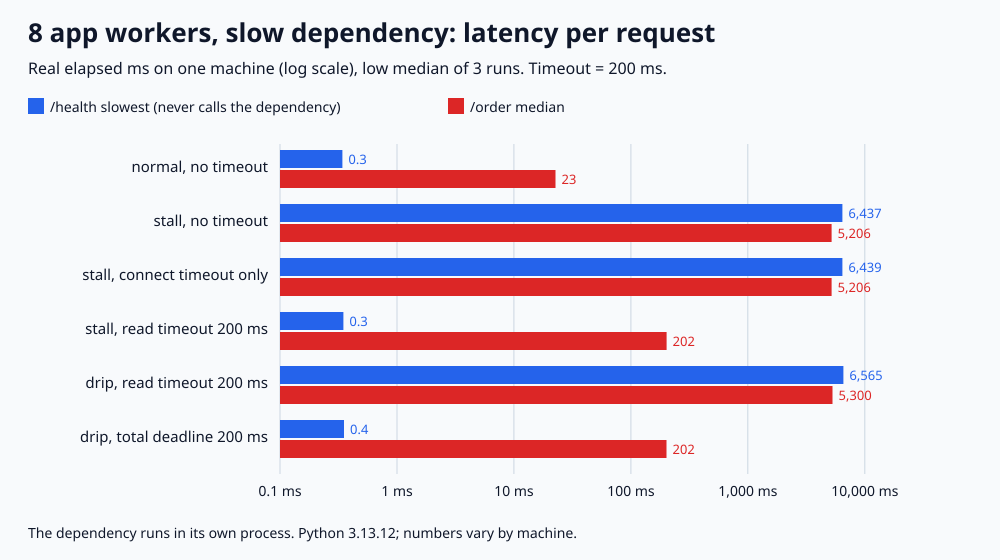

# 025. 타임아웃 없는 외부 호출이 서버를 막는 과정

> 워커 스레드 8개인 서버에서 외부 API가 2초 동안 응답하지 않게 했다. 타임아웃이 없으면 주문 40건이 워커 8개를 모두 붙잡아, 외부 API를 부르지도 않는 `/health`가 가장 느릴 때 6,437.2ms를 기다렸다. 읽기 타임아웃 200ms를 걸면 주문은 202.1ms에 504로 끝나고 `/health`는 0.3ms였다. 연결 타임아웃만 건 경우는 타임아웃이 없을 때와 같았다(6,439.1ms). 100ms마다 1바이트씩 흘려보내는 응답에는 200ms 읽기 타임아웃이 걸리지 않았고(6,564.7ms), 호출 전체에 200ms 기한을 둬야 끊겼다.

## 문제

외부 API가 죽지는 않고 느려지거나 멈췄을 때, 그 API를 부르는 서버에 어떤 일이 생기는지 잰다. 타임아웃이 없으면 얼마나 오래 막히는지, 그 API와 상관없는 요청까지 느려지는지, 연결 타임아웃·읽기 타임아웃·전체 기한이 각각 무엇을 막아 주는지 확인한다.

## 실험

```bash
python3 main.py
# 검증한 실행 결과로 그림도 다시 생성하려면
python3 main.py --write-svg
```

Python 3 표준 라이브러리만 사용한다. 실제 시계로 잰다(전체 약 2분 10초).

- 외부 API(의존 서버): 같은 스크립트를 별도 프로세스로 띄운 asyncio HTTP 서버다(127.0.0.1). 응답 방식은 셋이다.
  - **normal**: 20ms 뒤 응답
  - **stall**: 연결은 받고 2초 동안 아무것도 보내지 않다가 응답
  - **drip**: 헤더를 먼저 보내고 본문 20바이트를 100ms마다 1바이트씩 보냄(약 2초)
- 앱 서버: 워커 스레드 8개가 각자 `accept()`로 연결을 받는다. 고정 크기 요청 스레드 풀과 같고, 남는 연결은 listen backlog에서 기다린다.
  - `/order/<i>`: 외부 API를 블로킹 소켓으로 부르고 그 응답을 돌려준다. 타임아웃이 나면 504.
  - `/health`: 외부 API를 부르지 않고 바로 `ok`
- 앱이 외부 API를 부르는 방식
  - **타임아웃 없음**: `socket.create_connection(timeout=None)`
  - **연결 타임아웃만**: 연결할 때만 200ms, 연결 뒤 `settimeout(None)`
  - **읽기 타임아웃 200ms**: 연결과 매 `recv()`마다 200ms. 바이트가 도착할 때마다 다시 200ms를 기다린다.
  - **전체 기한 200ms**: 호출 시작부터 200ms. `recv()` 전마다 남은 시간으로 타임아웃을 다시 건다.
- 부하: 요청을 정해진 시각에 보낸다(앞 요청이 끝나길 기다리지 않음). `/order`는 50ms마다 40건(2초 동안 초당 20건), `/health`는 25ms부터 100ms마다 20건.

조건마다 3번 돌려 low median(가운데 값, 실제 실행값)과 최소~최대를 적는다. 지연 시간은 클라이언트가 요청을 보내기 시작해서 응답을 다 받을 때까지다. 매 실행에서 `/health`는 모두 `ok`, `/order`는 자기 번호의 응답을 받았는지(또는 기대한 504인지) assert로 확인한다. 실행 사이에는 의존 서버에 남은 작업이 0이 될 때까지 기다린다.

## 실제 결과와 환경

2026-11-05 실행: Python 3.13.12, macOS(Darwin 25.6.0), arm64, 로컬 루프백. 다른 컴퓨터에서는 수치가 달라진다.



| 외부 API | 앱의 호출 방식 | `/health` 중앙값 | `/health` 최대 | `/order` 중앙값 | `/order` 최대 | `/order` 결과 | 마지막 응답까지 |
|---|---|---:|---:|---:|---:|---|---:|
| normal | 타임아웃 없음 | 0.2ms | 0.3ms | 22.7ms | 23.0ms | 200 40건 | 1,980.3ms |
| stall | 타임아웃 없음 | 3,227.7ms | 6,437.2ms | 5,206.2ms | 8,419.7ms | 200 40건 | 10,366.7ms |
| stall | 연결 타임아웃만 | 3,228.4ms | 6,439.1ms | 5,206.5ms | 8,414.5ms | 200 40건 | 10,367.9ms |
| stall | 읽기 타임아웃 200ms | 0.2ms | 0.3ms | 202.1ms | 202.8ms | 504 40건 | 2,157.1ms |
| drip | 읽기 타임아웃 200ms | 3,290.2ms | 6,564.7ms | 5,300.1ms | 8,573.7ms | 200 40건 | 10,529.1ms |
| drip | 전체 기한 200ms | 0.2ms | 0.4ms | 201.6ms | 203.1ms | 504 40건 | 2,158.6ms |

각 값은 3번 실행한 값의 low median이다. 같은 칸의 최소~최대 차이는 모두 10ms 미만이었다(가장 큰 차이는 drip·읽기 타임아웃 행의 `/order` 최대 8,573.5~8,583.0ms). 마지막 응답까지는 첫 요청 시각부터 잰다. 마지막 요청은 1,950ms에 보낸다.

| 외부 API | 앱의 호출 방식 | 바쁜 앱 워커 최대 | 의존 서버가 본 동시 요청 최대 |
|---|---|---:|---:|
| normal | 타임아웃 없음 | 2 | 1 |
| stall | 타임아웃 없음 | 8 | 8 |
| stall | 연결 타임아웃만 | 8 | 8 |
| stall | 읽기 타임아웃 200ms | 5 | 40 |
| drip | 읽기 타임아웃 200ms | 8 | 8 |
| drip | 전체 기한 200ms | 5 | 9 |

- **느린 외부 API 하나가 상관없는 요청까지 막았다.** 타임아웃이 없으면 워커 8개가 2초씩 묶여 서버는 2초에 8건만 처리했다. 초당 20건이 들어오니 나머지는 backlog에 줄을 섰고, 외부 API를 부르지 않는 `/health`도 같은 줄에서 기다렸다(중앙값 3,227.7ms, 최대 6,437.2ms). 호출 하나는 2초였지만 마지막 주문은 보낸 지 8,419.7ms 뒤에 응답을 받았다.
- **연결 타임아웃만으로는 부족했다.** stall 서버는 연결을 바로 받아 주고 응답만 늦췄다. 연결 단계의 타임아웃은 걸릴 일이 없어서 결과가 타임아웃 없음과 같았다(`/health` 최대 6,439.1ms).
- **읽기 타임아웃을 걸면 워커가 200ms 만에 풀렸다.** 주문은 202.1ms에 504로 실패했지만 바쁜 워커는 최대 5개로 8개를 다 쓰지 않았고 `/health`는 0.3ms였다. 서버가 실패를 빨리 돌려준 덕에 나머지 요청이 살았다.
- **읽기 타임아웃은 호출 전체 시간이 아니다.** drip 서버는 100ms마다 1바이트를 보냈다. 200ms 읽기 타임아웃은 바이트가 올 때마다 다시 시작돼서 한 번도 걸리지 않았고, 호출마다 약 2초를 기다려 타임아웃 없음과 같았다(`/health` 최대 6,564.7ms). 호출 시작부터 200ms라는 전체 기한을 두자 201.6ms에 끊겼다.
- **앱이 포기해도 외부 API의 일은 남았다.** 읽기 타임아웃 행에서 앱은 202ms에 손을 뗐지만 의존 서버는 2초 대기를 계속해 동시 요청이 최대 40개였다(타임아웃 없음은 8개). 앱 쪽 동시 수가 줄어든 대신 상대 서버에는 요청이 그대로 쌓였다. drip에 전체 기한을 건 행은 9개였다. 끊긴 연결에 다음 바이트를 쓰다 오류가 나 그 작업이 일찍 끝났기 때문으로 보이지만, 이 경로를 따로 재지는 않았다.

### 회귀 검증

기본 실행에서 `regression_checks=28 PASS`를 확인했다. 정상 응답은 네 가지 호출 방식 모두에서 자기 번호를 받고 20ms 이상 걸리는지, stall에서 타임아웃 없음·연결 타임아웃만은 2초 이상 기다리는지, 읽기 타임아웃·전체 기한은 200ms 이상 500ms 미만에 끊기는지, drip은 읽기 타임아웃으로는 끊기지 않고(2초 이상) 전체 기한으로는 끊기는지 검사한다. 앱에서는 워커 8개가 stall 호출에 묶였을 때 `/health`가 1,800ms 이상 기다리고, 읽기 타임아웃이면 400ms 안에 답하는지 본다. 잘못된 입력(알 수 없는 호출 방식, 타임아웃 0, 워커 0개)도 거부하는지 확인한다. 본 실험에서도 매 실행의 응답 내용과 상태 코드, 최소 지연(성공은 외부 API 지연 이상, 504는 200ms 이상)을 assert로 확인한다. `-O`는 assert를 끄므로 프로그램이 실행을 거부한다.

## 배운 점과 한계

- 외부 호출에는 연결과 읽기 모두 타임아웃이 있어야 한다. Python 소켓은 기본이 타임아웃 없음(`None`)이고, `requests`도 `timeout`을 주지 않으면 기다림에 끝이 없다.
- 읽기 타임아웃은 "바이트 사이 간격"의 한도다. 응답 전체를 일정 시간 안에 끝내야 한다면 호출 전체 기한을 따로 두고 남은 시간을 매번 다시 건다.
- 타임아웃 값은 그 요청을 처리하는 워커를 얼마나 오래 내줄 수 있는지로 정한다. 이 실험은 200ms로 한 가지 값만 쟀다. 너무 짧으면 정상 응답도 끊고, 길면 이 실험의 타임아웃 없음 쪽에 가까워진다.
- 타임아웃은 내 워커만 풀어 준다. 상대 서버의 일은 계속되고, 같은 요청을 바로 재시도하면 상대에게 더 쌓인다. 재시도 간격은 [lab 021](../021-retry-backoff-jitter), 실패가 이어질 때 호출을 끊는 방법은 [lab 022](../022-circuit-breaker)에서 다뤘다.
- 외부 API별로 워커나 커넥션을 따로 나누는 방법(bulkhead), 비동기 서버에서의 차이, 실제 네트워크의 SYN 무응답(연결 타임아웃이 걸리는 경우), 커넥션 재사용은 재지 않았다. 워커 8개, 초당 20건, 2초 장애라는 한 가지 조건의 로컬 실험이다.

## 연결과 참고

- 면접 답변: [API-06](https://github.com/morningverse67-wq/backend-interview-lab/blob/main/api/external-call-timeout.md)
- 앞 실험: 기다림을 겹치는 방식은 [lab 024](../024-sync-threadpool-asyncio), 커넥션 대기 시간은 [lab 023](../023-connection-pool-size)
- [Python 문서: socket, 소켓 타임아웃에 관한 참고 사항](https://docs.python.org/3/library/socket.html#socket-timeouts)
- [Requests 문서: Timeouts (읽기 타임아웃은 서버가 보내는 바이트 사이의 대기 시간)](https://requests.readthedocs.io/en/latest/user/advanced/#timeouts)
- [Amazon Builders' Library: Timeouts, retries, and backoff with jitter](https://aws.amazon.com/builders-library/timeouts-retries-and-backoff-with-jitter/)
