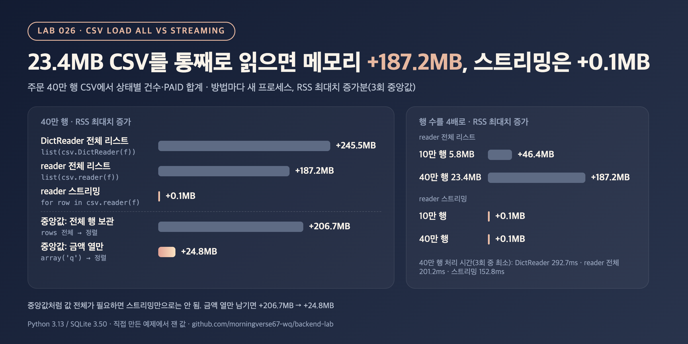

# 026. 대용량 CSV, 한 번에 읽기 vs 스트리밍 (메모리 측정)

> 23.4MB짜리 주문 CSV를 `list(csv.reader(f))`로 한 번에 읽어 집계하니 프로세스 메모리 최대치가 187.2MB 늘었다. 같은 집계를 한 행씩 읽으며 하면 0.1MB였고, 시간도 201.2ms → 152.8ms로 오히려 줄었다.

## 문제

CSV를 처리할 때 가장 먼저 떠오르는 코드는 파일 전체를 리스트로 읽는 것이다.

```python
rows = list(csv.DictReader(f))        # 한 번에 읽기: 모든 행이 메모리에
for r in rows: ...

for row in csv.reader(f): ...         # 스트리밍: 지금 행 하나만 메모리에
```

파일이 커지면 한 번에 읽는 쪽은 메모리를 얼마나 더 쓰는지, 스트리밍은 정말 그대로인지, 스트리밍으로 안 되는 집계(중앙값)는 어떻게 하는지 잰다.

## 실험

- 주문 CSV를 만든다: `order_id, user_id, status, amount, created_at, memo` 6개 열, 10만 행(5.8MB)과 40만 행(23.4MB), 시드 고정
- 할 일: 상태별 건수와 PAID 금액 합계. 아래 다섯 방법으로 같은 답을 낸다.
  - **DictReader 전체 리스트**: `list(csv.DictReader(f))` 뒤 집계
  - **reader 전체 리스트**: `list(csv.reader(f))` 뒤 집계
  - **reader 스트리밍**: `for row in csv.reader(f)`로 읽으며 합계만 유지
  - **중앙값: 전체 행 보관**: 금액 중앙값을 구하려고 모든 행을 리스트로 읽은 뒤 정렬
  - **중앙값: 금액 열만 보관**: 스트리밍하며 금액만 `array('q')`에 모은 뒤 정렬
- 방법마다 **새 프로세스**에서 돌린다. 한 프로세스에서 연달아 돌리면 앞 방법이 늘려 놓은 메모리가 섞이기 때문이다.
  - RSS 최대치 증가: 작업 전후 `resource.getrusage().ru_maxrss` 차이(OS가 본 프로세스 메모리 최대치). 3회 중앙값
  - tracemalloc 최대치: Python이 할당한 바이트의 최대치. tracemalloc이 작업을 느리게 해서 따로 1회 돌린다
  - 시간: 3회 중 최소값. 파일은 미리 한 번 읽어 OS 캐시에 올려 두었다(디스크 읽기 시간은 빠짐)
- 다섯 방법이 같은 건수·합계·중앙값을 내는지, 중앙값은 SQLite `ORDER BY ... LIMIT 1 OFFSET`으로 한 번 더 `assert`로 확인한다

```bash
python3 main.py
```

## 결과



40만 행, 23.4MB

| 방법 | 시간 (ms) | RSS 최대치 증가 (MB) | tracemalloc 최대치 (MB) | 파일 크기 대비 |
|---|---:|---:|---:|---:|
| DictReader 전체 리스트 | 292.7 | 245.5 | 231.13 | 9.87배 |
| reader 전체 리스트 | 201.2 | 187.2 | 170.33 | 7.27배 |
| reader 스트리밍 | 152.8 | 0.1 | 0.05 | 0.00배 |
| 중앙값: 전체 행 보관 | 222.4 | 206.7 | 188.01 | 8.03배 |
| 중앙값: 금액 열만 보관 | 170.2 | 24.8 | 22.51 | 0.96배 |

10만 행, 5.8MB

| 방법 | 시간 (ms) | RSS 최대치 증가 (MB) | tracemalloc 최대치 (MB) | 파일 크기 대비 |
|---|---:|---:|---:|---:|
| DictReader 전체 리스트 | 72.7 | 60.9 | 57.70 | 10.00배 |
| reader 전체 리스트 | 44.3 | 46.4 | 42.50 | 7.37배 |
| reader 스트리밍 | 37.3 | 0.1 | 0.05 | 0.01배 |
| 중앙값: 전체 행 보관 | 49.1 | 51.4 | 46.89 | 8.13배 |
| 중앙값: 금액 열만 보관 | 42.0 | 5.9 | 5.64 | 0.98배 |

"파일 크기 대비"는 tracemalloc 최대치 ÷ 파일 크기다. 40만 행의 답은 PAID 279,646건, 합계 41,938,826,600원, 금액 중앙값 149,600원으로 다섯 방법이 모두 같았다.

<sub>Python 3.13.12 / SQLite 3.50.4, macOS arm64. 시간은 3회 중 최소값, RSS는 3회 중앙값, tracemalloc은 따로 1회. 환경에 따라 수치는 달라질 수 있음.</sub>

## 배운 점

- 한 번에 읽으면 메모리는 **파일 크기가 아니라 파이썬 객체 크기**만큼 든다. 23.4MB 파일이 행 리스트로는 7.27배, dict 리스트로는 9.87배가 됐다. 행마다 리스트(또는 dict)와 문자열 객체 6개가 따로 생기기 때문이다.
- 한 번에 읽는 쪽은 행 수에 비례해 늘었고(10만 행 46.4MB → 40만 행 187.2MB), 스트리밍은 두 크기 모두 0.1MB였다. 합계·건수처럼 한 행씩 누적할 수 있는 집계라면 스트리밍이 메모리와 시간 모두 이득이었다(201.2ms → 152.8ms, 큰 리스트를 만들지 않으니까).
- 중앙값·정렬·여러 번 훑기처럼 값 전체가 필요한 작업은 스트리밍만으로 끝나지 않는다. 이때는 필요한 열만 남기는 것이 현실적인 절충이었다(206.7MB → 24.8MB). 금액 배열 자체는 40만 × 8바이트 = 3.2MB라서, 나머지는 `sorted()`가 만든 int 리스트 몫으로 보인다(따로 나눠 재지는 않았다).
- 스트리밍이 항상 답은 아니다. 10만 행처럼 수십 MB로 끝나는 파일이면 한 번에 읽는 코드가 더 단순하고, 행끼리 오가며 봐야 하는 작업은 결국 DB에 넣고 SQL로 처리하는 편이 낫다. 스트리밍 루프 안에서 행을 다시 리스트에 쌓으면 이득도 사라진다.
