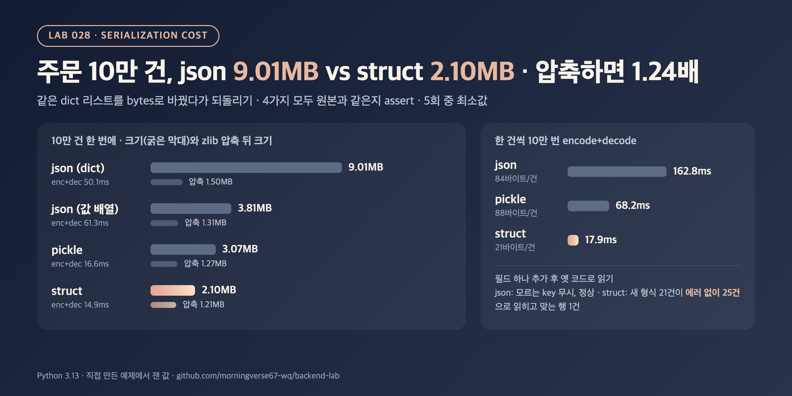

# 028. 직렬화 비용: json vs pickle vs struct

> 같은 주문 10만 건이 json으로는 9.01MB, 고정 길이 struct로는 2.10MB였다(4.29배). 그런데 zlib으로 압축하면 1.50MB vs 1.21MB, 차이는 1.24배로 줄었다. 필드 하나를 추가하자 옛 struct 코드는 새 데이터 21건을 에러 없이 25건으로 잘못 읽었다.

## 문제

캐시에 값을 넣거나, 큐에 메시지를 보내거나, 파일로 내보낼 때 객체는 bytes가 되어야 한다.

```python
json.dumps(rows).encode()            # 사람이 읽을 수 있고, 어느 언어에서나 읽힘
pickle.dumps(rows, protocol=5)       # Python 객체 그대로, Python에서만
struct.Struct("<IIBIq").pack(...)    # 필드 순서와 크기를 코드로 고정한 바이너리
```

형식에 따라 크기와 시간이 얼마나 다른지, 그 차이가 압축이나 한 건씩 직렬화할 때도 유지되는지, 바이너리 형식이 무엇을 잃는지 잰다.

## 실험

- 주문 10만 건: `order_id, user_id, status, amount, created_at` 5개 필드 dict 리스트, 시드 고정
- 네 가지 방법으로 bytes로 바꿨다가 다시 dict 리스트로 되돌린다. 결과가 원본과 같은지 `assert`로 확인한다.
  - **json (dict)**: `json.dumps(rows, separators=(",", ":"))`, key 이름이 행마다 들어감
  - **json (값 배열)**: key 없이 `[[1, 2, "PAID", ...], ...]`로 보내고 받는 쪽에서 dict로 다시 만듦
  - **pickle**: `pickle.dumps(rows, protocol=5)`
  - **struct**: 행마다 `<IIBIq` 21바이트(status는 1바이트 코드), 읽을 때 dict로 다시 만듦
- 크기, zlib(level 6) 압축 뒤 크기, encode 시간, decode 시간. 시간은 5회 중 최소값(압축 시간은 재지 않음)
- 한 건씩: 캐시 값 하나처럼 dict 한 개를 encode+decode, 이것을 10만 번
- 형식 변경: 새 필드 `coupon_id`를 추가한 데이터를 옛 코드(필드 5개 기준)로 읽어 본다

```bash
python3 main.py
```

## 결과



10만 건 한 번에

| 방법 | 크기 (MB) | zlib 압축 뒤 (MB) | encode (ms) | decode (ms) |
|---|---:|---:|---:|---:|
| json (dict, key 포함) | 9.01 | 1.50 | 22.6 | 27.5 |
| json (값 배열, key 없음) | 3.81 | 1.31 | 24.7 | 36.6 |
| pickle (protocol 5) | 3.07 | 1.27 | 7.6 | 9.0 |
| struct (고정 21바이트) | 2.10 | 1.21 | 6.9 | 8.0 |

크기는 json이 struct의 4.29배, 압축 뒤에는 1.24배. encode+decode 합계는 json 50.1ms, struct 14.9ms.

한 건씩 10만 번 (encode+decode)

| 방법 | 1건 크기 (바이트) | 합계 (ms) | 1건당 (µs) |
|---|---:|---:|---:|
| json | 84 | 162.8 | 1.63 |
| pickle | 88 | 68.2 | 0.68 |
| struct | 21 | 17.9 | 0.18 |

필드 하나(`coupon_id`)를 추가한 데이터를 옛 코드로 읽으면

```text
json  : OK (모르는 key는 무시)
struct: struct.error (unpack requires a buffer of 21 bytes)
struct, 새 형식 21건을 옛 코드로 읽기: 에러 없이 25건으로 읽힘, order_id·amount가 맞는 행 1건
```

<sub>Python 3.13.12, macOS arm64. MB는 1,000,000바이트. 시간은 5회 중 최소값. 환경에 따라 수치는 달라질 수 있음.</sub>

## 배운 점

- json 크기의 절반 이상은 **행마다 반복되는 key 이름**이었다. key만 빼도 9.01MB → 3.81MB. pickle이 10만 건에서 3.07MB로 작았던 것도 같은 key 문자열을 한 번만 저장하고 다시 가리키기 때문으로 보인다. 그래서 한 건만 직렬화하면 pickle은 88바이트로 json(84바이트)보다 오히려 컸다.
- 전송이나 저장에서 압축을 한다면 크기 차이는 4.29배 → 1.24배로 줄었다. 압축이 반복되는 key를 대부분 지워 주기 때문이다. "바이너리로 바꾸면 트래픽이 4분의 1"이라고 말하려면 압축 여부부터 확인해야 한다.
- 시간은 struct가 json보다 3.4배(10만 건 encode+decode 50.1ms vs 14.9ms), 한 건씩이면 9.1배 빨랐다. 하지만 한 건 기준 json도 1.63µs였다. 요청 하나에 DB 조회나 네트워크 왕복이 몇 ms 걸리는 API라면 이 차이는 거의 보이지 않는다. 직렬화가 병목인지는 프로파일로 먼저 확인하는 게 맞다.
- struct는 가장 작고 빠른 대신 필드 순서·크기를 양쪽 코드가 똑같이 알아야 한다. 필드 하나를 추가하자 옛 코드는 한 건이면 에러를 냈지만, 21건을 이어 붙인 데이터는 길이가 우연히 21의 배수(525바이트)여서 에러 없이 25건의 엉뚱한 값을 읽었다. 형식이 바뀔 수 있는 데이터라면 버전 필드나 길이를 같이 넣거나 스키마가 있는 형식을 써야 한다. pickle은 Python 전용이고, 공식 문서대로 믿을 수 없는 데이터를 `pickle.loads`하면 안 된다.
