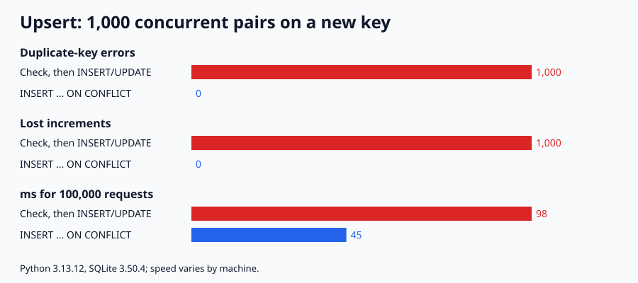

# 034. UPSERT: 조회 후 INSERT/UPDATE vs INSERT ... ON CONFLICT

> 같은 새 키에 요청 2개가 동시에 도착하는 상황 1,000쌍을 재현했다. "조회하고, 없으면 INSERT, 있으면 UPDATE" 방식은 중복 키 오류 1,000번과 사라진 증가분 1,000을 냈다. `INSERT ... ON CONFLICT DO UPDATE`는 오류 0, 사라진 증가분 0이었다. 같은 요청 10만 건을 처리하는 데 98ms 대 45ms가 걸렸다.

## 문제

카운터나 "마지막 값" 테이블에 쓸 때 흔히 "먼저 SELECT, 없으면 INSERT, 있으면 UPDATE"로 짠다. 요청 둘이 동시에 같은 새 키를 보면 둘 다 "없음"이라고 판단한다. 그 뒤에 무슨 일이 생기는지, 한 문장으로 끝나는 UPSERT는 어떻게 다른지 잰다.

## 실험

- 경합: 키 1,000개, 키마다 요청 A·B가 둘 다 조회를 끝낸 뒤 쓰도록 순서를 고정(같은 순서가 매번 재현됨). 기대 합계는 2,000
- 속도: 키 1,000개에 요청 10만 건(`random.Random(34)`), 한 트랜잭션, 5번 중 중앙값
- SQLite 인메모리 DB, 파이썬 `sqlite3`

```bash
python3 main.py              # 표 출력
python3 main.py --write-svg  # result.svg 다시 그리기
```

## 결과



| 방식 | 중복 키 오류 | 사라진 증가분 | 10만 건 ms |
|---|---:|---:|---:|
| 조회 후 INSERT/UPDATE | 1,000 | 1,000 | 98 |
| INSERT ... ON CONFLICT | 0 | 0 | 45 |

<sub>Python 3.13.12, SQLite 3.50.4, macOS arm64. 경합 수치는 고정된 순서라 매번 같고, ms는 실행마다 달라진다(같은 코드를 여러 번 돌렸을 때 조회 후 쓰기 98~148, ON CONFLICT 45~62).</sub>

## 배운 점

- 조회 후 쓰기는 둘 다 "없음"을 본 쌍마다 두 번째 INSERT가 중복 키 오류가 됐다(1,000쌍 → 1,000번). 오류를 무시하면 증가분이 사라져 합계가 2,000이 아니라 1,000이었다.
- ON CONFLICT는 판단과 쓰기가 한 문장이라 사이에 끼어들 틈이 없다. 합계가 정확히 2,000이었다.
- 문장이 하나라 SQL 왕복도 절반이다. 이 실험에서는 같은 10만 건이 약 2배 빨랐다.
- 이 실험은 한 프로세스에서 순서를 고정해 재현했다. 실제 DB 서버와 다중 연결 환경의 수치는 다를 수 있다.
