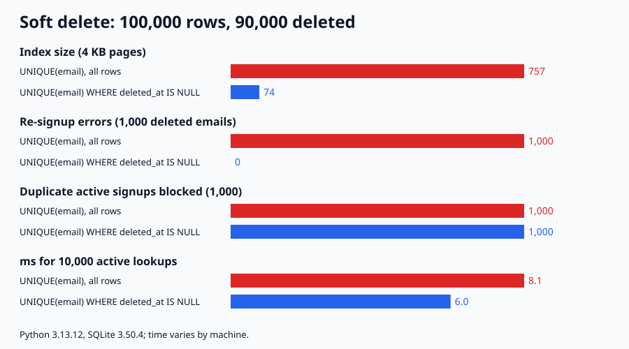

# 035. Soft delete와 부분 인덱스: 전체 UNIQUE vs `WHERE deleted_at IS NULL`

> 회원 10만 행 중 9만 행이 soft delete(`deleted_at` 있음)된 테이블에서 이메일 유니크 인덱스를 두 가지로 걸었다. 전체 행에 건 `UNIQUE(email)`은 탈퇴한 이메일 1,000개의 재가입을 1,000번 모두 막았고 인덱스가 757페이지였다. `WHERE deleted_at IS NULL` 부분 인덱스는 재가입 오류 0, 활동 중인 이메일 중복 가입 1,000번은 똑같이 다 막았고, 인덱스는 74페이지였다.

## 문제

삭제를 `deleted_at` 표시로 대신하면 지운 행이 테이블에 계속 남는다. 이메일에 그냥 UNIQUE를 걸면 탈퇴한 사람이 같은 이메일로 다시 가입할 수 없고, 인덱스도 지운 행까지 담는다. 살아 있는 행에만 거는 부분 인덱스로 무엇이 달라지는지 잰다.

## 실험

- 회원 10만 행, 그중 활동 1만 행·삭제 9만 행
- 재가입: 삭제된 이메일 1,000개로 다시 INSERT / 중복 가입: 활동 중인 이메일 1,000개로 또 INSERT
- 인덱스 크기: 인덱스 만들기 전후 `PRAGMA page_count` 차이(페이지 4KB)
- 조회: `WHERE email=? AND deleted_at IS NULL` 1만 건(`random.Random(35)`), 5번 중 중앙값. 두 경우 모두 `EXPLAIN QUERY PLAN`으로 인덱스를 타는지 확인
- SQLite 인메모리 DB, 파이썬 `sqlite3`

```bash
python3 main.py              # 표 출력
python3 main.py --write-svg  # result.svg 다시 그리기
```

## 결과



| 방식 | 인덱스 페이지 | 재가입 오류 | 활동 중 중복 막음 | 조회 1만 건 ms |
|---|---:|---:|---:|---:|
| 전체 UNIQUE(email) | 757 | 1,000 | 1,000 | 8.1 |
| 부분 UNIQUE(email) WHERE deleted_at IS NULL | 74 | 0 | 1,000 | 6.0 |

<sub>Python 3.13.12, SQLite 3.50.4, macOS arm64. 페이지 수와 오류 건수는 매번 같고, ms는 실행마다 조금씩 달라진다(여러 번 돌려 전체 7.9~8.2, 부분 5.9~6.4).</sub>

## 배운 점

- 전체 UNIQUE는 지운 행의 이메일도 "사용 중"으로 본다. 탈퇴한 이메일 1,000개의 재가입이 모두 오류였다.
- 부분 UNIQUE는 살아 있는 행끼리만 유일성을 본다. 재가입은 0건 오류, 활동 중인 이메일 중복은 1,000건 모두 막혔다.
- 삭제가 90%인 테이블이라 부분 인덱스는 약 10분의 1 크기(757 → 74페이지)였고, 조회도 조금 빨랐다.
- 쿼리 조건에 `deleted_at IS NULL`이 인덱스 조건과 똑같이 있어야 부분 인덱스를 쓴다. 이 실험은 실행 계획으로 확인했다.
- SQLite 인메모리 결과라 실제 DB 서버의 수치는 다를 수 있다. PostgreSQL·SQLite는 부분 인덱스를 지원하고, MySQL은 생성 컬럼 같은 다른 방법을 쓴다.
