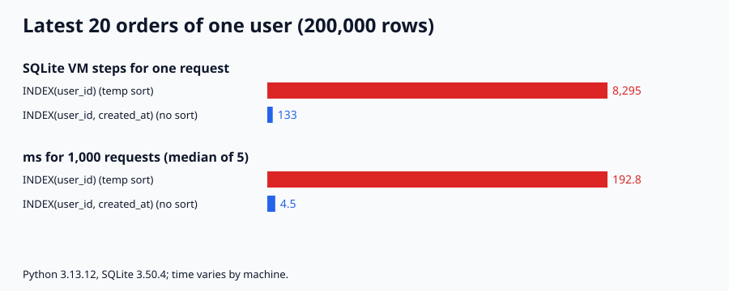

# 036. 정렬 인덱스로 `ORDER BY ... LIMIT`의 정렬 단계 없애기

> 주문 20만 행에서 "회원 한 명의 최근 주문 20건"(`WHERE user_id=? ORDER BY created_at DESC LIMIT 20`)을 두 가지 인덱스로 돌렸다. `INDEX(user_id)`는 그 회원의 주문 약 1,000건을 다 모아 임시 B-tree로 정렬했고(요청 1번에 VM 8,295단계, 1,000번에 192.8ms), `INDEX(user_id, created_at)`는 인덱스 순서대로 20건만 읽고 멈춰 정렬 단계가 없었다(133단계, 4.5ms).

## 문제

`WHERE`로 거른 뒤 `ORDER BY ... LIMIT`을 하는 목록 API는 흔하다. 거르는 컬럼에만 인덱스가 있으면 DB는 조건에 맞는 행을 모두 꺼내 정렬한 다음 앞의 20건만 돌려준다. 정렬 컬럼까지 인덱스에 넣으면 무엇이 달라지는지 잰다.

## 실험

- 주문 20만 행, 회원 200명(회원당 평균 1,000건), `random.Random(36)`으로 생성
- 쿼리: `SELECT id, created_at FROM orders WHERE user_id=? ORDER BY created_at DESC LIMIT 20`
- 비교: `INDEX(user_id)` vs `INDEX(user_id, created_at)`, 만든 뒤 `ANALYZE`
- 정렬 단계: `EXPLAIN QUERY PLAN`에 `USE TEMP B-TREE FOR ORDER BY`가 있는지
- 일의 양: 요청 1번(회원 7)에 SQLite VM이 실행한 단계 수(`set_progress_handler(..., 1)`)
- 시간: 무작위 회원 1,000명 요청(`random.Random(360)`), 5번 중 중앙값
- 두 인덱스가 같은 20건을 같은 순서로 돌려주는지 테스트로 확인
- SQLite 인메모리 DB, 파이썬 `sqlite3`

```bash
python3 main.py              # 표 출력
python3 main.py --write-svg  # result.svg 다시 그리기
```

## 결과



| 인덱스 | 정렬 단계(TEMP B-TREE) | 요청 1번 VM 단계 | 요청 1,000번 ms |
|---|---|---:|---:|
| INDEX(user_id) | 있음 | 8,295 | 192.8 |
| INDEX(user_id, created_at) | 없음 | 133 | 4.5 |

<sub>Python 3.13.12, SQLite 3.50.4, macOS arm64. 실행 계획과 VM 단계 수는 매번 같고, ms는 실행마다 달라진다(여러 번 돌려 192.8~249.6 / 4.5~6.6).</sub>

## 배운 점

- `INDEX(user_id)`만 있으면 회원 한 명의 주문을 전부 읽고 정렬한 뒤 앞의 20건만 남긴다. 읽는 양이 LIMIT이 아니라 그 회원의 주문 수에 비례한다.
- `(user_id, created_at)` 인덱스는 같은 `user_id` 안에서 이미 `created_at` 순서라, 뒤에서부터 20건을 읽고 바로 멈춘다. 실행 계획에서 정렬 단계가 사라졌다.
- 이 쿼리는 `id, created_at`만 고르므로 두 번째 인덱스는 커버링 인덱스(007)도 됐다. 시간 차이에는 테이블을 다시 읽지 않는 효과도 섞여 있다. 정렬 단계가 없어진 것은 실행 계획으로 따로 확인했다.
- 인덱스 컬럼 순서는 "같음 조건 컬럼 먼저, 정렬 컬럼 다음"이어야 한다(004 복합 인덱스 순서와 같은 이야기).
- SQLite 인메모리 결과라 실제 DB 서버의 수치는 다를 수 있다. 참고: [SQLite 쿼리 최적화 – ORDER BY](https://www.sqlite.org/optoverview.html#order_by_optimizations), [PostgreSQL 인덱스와 ORDER BY](https://www.postgresql.org/docs/current/indexes-ordering.html).
