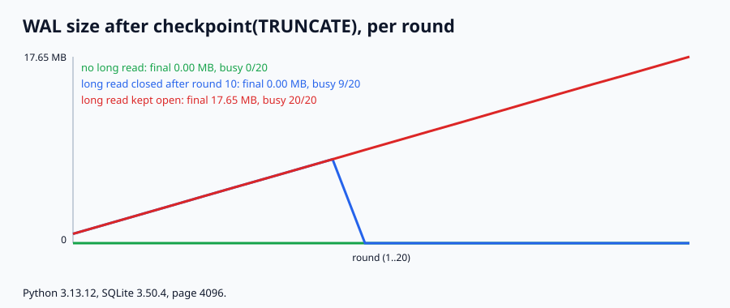

# 037. 긴 트랜잭션이 막는 정리 작업: 오래 열린 읽기가 남기는 옛 버전 행

> 계좌 1만 행에 1,000건씩 20번 UPDATE하고 묶음마다 WAL 정리(`wal_checkpoint(TRUNCATE)`)를 불렀다. 긴 읽기가 없으면 20번 모두 정리돼 WAL이 0 MB로 돌아갔고, 읽기 트랜잭션 하나를 끝까지 열어 두면 20번 모두 busy로 정리가 막혀 WAL이 17.65 MB까지 쌓였다. 그 읽기는 끝까지 처음 스냅샷(잔액 합계 10,000,000)을 봤고, 닫자마자 다음 정리에서 WAL이 0 MB가 됐다.

## 문제

MVCC를 쓰는 DB는 바뀐 행의 옛 버전을 바로 버리지 않는다. 아직 그 버전을 볼 수 있는 트랜잭션이 남아 있으면 정리(PostgreSQL VACUUM, MySQL purge, SQLite WAL checkpoint)가 그 앞에서 멈춘다. 오래 열린 읽기 하나가 정리를 얼마나 막는지, 닫으면 어떻게 되는지 잰다.

## 실험

- 계좌 1만 행(행마다 메모 80자), SQLite 파일 DB, `journal_mode=WAL`, 자동 정리 끔(`wal_autocheckpoint=0`)
- 쓰기: 무작위 계좌 1,000건 `balance + 1` UPDATE를 한 트랜잭션으로, 20번(`random.Random(37)`)
- 묶음마다 `PRAGMA wal_checkpoint(TRUNCATE)`를 부르고 busy 여부와 WAL 파일 크기를 기록
- 비교 3가지: 긴 읽기 없음 / 다른 연결이 `BEGIN` 후 `SELECT`한 채 10번째 묶음 뒤에 닫음 / 끝까지 열어 둠
- 긴 읽기가 끝에 다시 읽은 잔액 합계와, 닫은 뒤 정리했을 때 WAL 크기도 확인
- 파이썬 `sqlite3`, 표준 라이브러리만 사용

```bash
python3 main.py              # 표 출력
python3 main.py --write-svg  # result.svg 다시 그리기
```

## 결과



| 상황 | 정리 실패(busy) | WAL 최대 MB | 마지막 WAL MB |
|---|---:|---:|---:|
| 긴 읽기 없음 | 0/20 | 0.00 | 0.00 |
| 긴 읽기를 10번째 묶음 뒤에 닫음 | 9/20 | 7.94 | 0.00 |
| 긴 읽기가 끝까지 열려 있음 | 20/20 | 17.65 | 17.65 |

- 끝까지 열린 읽기가 마지막에 본 잔액 합계는 10,000,000(쓰기 쪽은 10,020,000), 그 읽기를 닫은 뒤 정리하자 WAL 0.00 MB.

<sub>Python 3.13.12, SQLite 3.50.4, macOS arm64, 페이지 4096바이트. 같은 시드라 여러 번 돌려도 숫자가 같았다.</sub>

## 배운 점

- 정리는 "가장 오래된 열린 스냅샷" 앞까지만 할 수 있다. 읽기 하나가 열려 있는 동안 쓰기가 만든 변경분이 전부 남아, WAL이 묶음마다 약 0.9 MB씩 늘었다.
- 오래 열린 읽기는 계속 옛 데이터를 본다. 리포트·배치가 트랜잭션을 열어 둔 채 오래 돌면 결과도 시작 시점 기준이다.
- 원인을 닫으면 바로 정리된다. 중간에 닫은 경우 7.94 MB까지 쌓였다가 다음 정리에서 0 MB가 됐다.
- PostgreSQL에서는 같은 일이 dead tuple과 테이블 bloat로 나타난다. `pg_stat_activity`의 `xact_start`로 오래된 트랜잭션을 찾고, `idle_in_transaction_session_timeout`으로 끊는다.
- SQLite WAL 파일 크기로 잰 결과라 다른 DB의 수치와는 다르다. 참고: [SQLite WAL – checkpoint starvation](https://www.sqlite.org/wal.html#avoiding_excessively_large_wal_files), [PostgreSQL routine vacuuming](https://www.postgresql.org/docs/current/routine-vacuuming.html).
