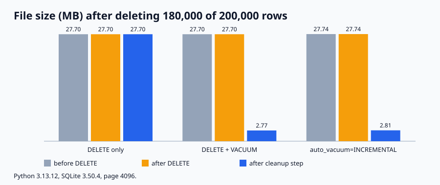

# 038. 대량 DELETE 뒤 파일 크기: freelist와 VACUUM

> 로그 20만 행 중 오래된 18만 행(90%)을 DELETE했더니 파일은 27.70 MB 그대로였고, 빈 페이지 6,373개가 freelist로 갔다. 그 파일에 18만 행을 다시 넣자 빈 페이지를 먼저 써서 27.91 MB로 거의 그대로였다. `VACUUM`을 돌리면 2.77 MB, `auto_vacuum=INCREMENTAL`로 만든 파일은 `incremental_vacuum` 한 번에 2.81 MB가 됐다.

## 문제

오래된 로그·이력을 대량으로 지워도 디스크 사용량이 그대로인 경우가 많다. 지운 자리가 어디로 가는지, 파일을 실제로 줄이려면 무엇을 해야 하는지 잰다.

## 실험

- 로그 테이블 `logs(id, created_at, body)` 20만 행(본문 약 115자), `created_at` 인덱스, SQLite 파일 DB(페이지 4096바이트)
- `DELETE FROM logs WHERE created_at < 180000`로 오래된 90%를 지움
- 비교 3가지: DELETE만 / DELETE 뒤 `VACUUM` / 처음부터 `PRAGMA auto_vacuum=INCREMENTAL`로 만들고 DELETE 뒤 `PRAGMA incremental_vacuum`
- 단계마다 파일 크기, `page_count`, `freelist_count`를 기록하고 끝에 `integrity_check`
- DELETE만 한 파일에는 지운 만큼(18만 행) 다시 넣어 빈 페이지가 재사용되는지 확인
- 파이썬 `sqlite3`, 표준 라이브러리만 사용

```bash
python3 main.py              # 표 출력
python3 main.py --write-svg  # result.svg 다시 그리기
```

## 결과



| 방법 | DELETE 전 MB | DELETE 뒤 MB (빈 페이지) | 정리 뒤 MB (빈 페이지) |
|---|---:|---:|---:|
| DELETE만 | 27.70 | 27.70 (6,373) | 27.70 (6,373) |
| DELETE 뒤 VACUUM | 27.70 | 27.70 (6,373) | 2.77 (0) |
| auto_vacuum=INCREMENTAL + incremental_vacuum | 27.74 | 27.74 (6,373) | 2.81 (0) |

- DELETE만 한 파일에 18만 행을 다시 넣은 뒤: 27.91 MB, 빈 페이지 0개, 전체 페이지 7,092 → 7,145(53개만 늘어남).

<sub>Python 3.13.12, SQLite 3.50.4, macOS arm64, 페이지 4096바이트. 데이터가 고정이라 여러 번 돌려도 숫자가 같았다.</sub>

## 배운 점

- DELETE는 행을 지우고 비게 된 페이지를 freelist에 올려 둘 뿐, 파일 크기는 그대로다. 디스크 사용량만 보고 "안 지워졌다"고 판단하면 틀린다.
- 빈 페이지는 다음 INSERT가 먼저 쓴다. 지우고 다시 쌓이는 테이블이면 파일을 줄일 필요가 크지 않다.
- 실제로 줄이려면 `VACUUM`(새 파일로 다시 쓰기)이나 `auto_vacuum=INCREMENTAL` + `incremental_vacuum`이 필요하다. `auto_vacuum`은 테이블을 만들기 전에 정하거나, 바꾼 뒤 `VACUUM`을 한 번 해야 적용된다.
- PostgreSQL도 비슷하다. 일반 `VACUUM`은 빈 공간을 재사용 가능하게 표시하고, 파일을 OS에 돌려주려면 `VACUUM FULL`(테이블 잠금)이나 pg_repack 같은 재작성이 필요하다. 그래서 대량 삭제가 잦은 로그는 날짜 파티션을 통째로 떼어 내는 방법을 많이 쓴다.
- SQLite 파일 크기로 잰 결과라 다른 DB 수치와는 다르다. 참고: [SQLite VACUUM](https://www.sqlite.org/lang_vacuum.html), [SQLite auto_vacuum](https://www.sqlite.org/pragma.html#pragma_auto_vacuum), [PostgreSQL routine vacuuming](https://www.postgresql.org/docs/current/routine-vacuuming.html).
