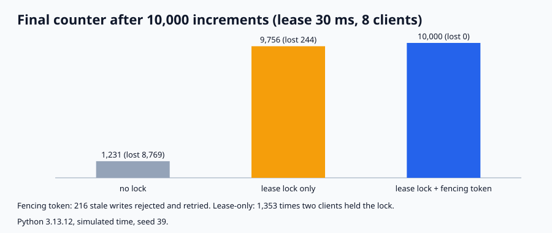

# 039. 분산 락의 임대 시간(lease) 초과와 fencing token

> 작업자 8명이 임대 시간 30 ms짜리 락을 잡고 카운터를 1씩 1만 번 올렸다. 2% 확률로 작업 중 40~120 ms 멈추게 했더니, 임대 락만 쓴 경우 최종 카운터는 9,756으로 244번이 사라졌다. 저장소가 fencing token(락을 줄 때마다 1씩 커지는 번호)보다 작은 번호의 쓰기를 거절하게 하자 늦게 온 쓰기 216건이 거절·재시도됐고 카운터는 정확히 10,000이 됐다.

## 문제

락에 임대 시간을 두면 락을 쥔 프로세스가 죽어도 락이 풀린다. 그런데 프로세스가 죽지 않고 잠깐 멈췄다가(GC, 네트워크 지연) 돌아오면, 이미 락은 다른 작업자에게 넘어갔는데도 자기가 락을 쥐었다고 믿고 쓴다. 이때 몇 건이 사라지는지, fencing token으로 막을 수 있는지 잰다.

## 실험

- 공유 카운터를 읽고 +1 해서 쓰는 작업 1만 개, 작업자 8명
- 작업 시간 5~15 ms, 2% 확률로 40~120 ms 더 멈춤, 락 임대 시간 30 ms
- 비교 3가지: 락 없음 / 임대 락만 / 임대 락 + fencing token(저장소가 지금까지 본 가장 큰 번호보다 작은 번호의 쓰기를 거절, 거절된 작업은 다시 줄을 섬)
- 실제 시간 대신 이벤트 시뮬레이션(시드 39)이라 여러 번 돌려도 숫자가 같다
- 파이썬 표준 라이브러리만 사용

```bash
python3 main.py              # 표 출력
python3 main.py --write-svg  # result.svg 다시 그리기
```

## 결과



| 방법 | 작업 수 | 최종 카운터 | 잃은 증가 수 | 옛 작업자가 쓰기 전에 락을 새로 내준 횟수 | 거절된 쓰기 | 걸린 시간(시뮬레이션 초) |
|---|---:|---:|---:|---:|---:|---:|
| 락 없음 | 10,000 | 1,231 | 8,769 | - | 0 | 14.7 |
| 임대 락만 | 10,000 | 9,756 | 244 | 1,353 | 0 | 103.9 |
| 임대 락 + fencing token | 10,000 | 10,000 | 0 | 1,407 | 216 | 106.3 |

<sub>Python 3.13.12, macOS arm64, 시뮬레이션 시간(시드 39). 여러 번 돌려도 숫자가 같았다.</sub>

## 배운 점

- 임대 시간은 "락을 쥔 쪽이 죽었을 때" 문제를 풀지만 "멈췄다 돌아온 쪽"은 막지 못한다. 실험에서 락이 넘어간 뒤 옛 작업자가 쓴 경우 때문에 244번이 사라졌다.
- 임대 시간을 늘리면 덜 겹치지만, 멈춤이 그보다 길면 똑같이 생긴다. 락 쪽만으로는 끝나지 않는다.
- fencing token은 확인을 저장소 쪽에서 한다. 락을 줄 때마다 커지는 번호를 함께 보내고, 저장소가 더 작은 번호의 쓰기를 거절하면 늦게 온 쓰기가 반영되지 않는다. 비용은 거절된 216건의 재시도(걸린 시간 103.9 → 106.3초)였다.
- 저장소가 번호를 확인할 수 있어야 쓸 수 있다. DB라면 `UPDATE ... WHERE token < :token` 같은 조건부 쓰기나 version 컬럼(lab 010)과 같은 원리다.
- 시뮬레이션이라 실제 락 서버·네트워크 수치와는 다르다. 참고: [Martin Kleppmann, How to do distributed locking](https://martin.kleppmann.com/2016/02/08/how-to-do-distributed-locking.html), [Apache ZooKeeper recipes: locks](https://zookeeper.apache.org/doc/current/recipes.html#sc_recipes_Locks).
