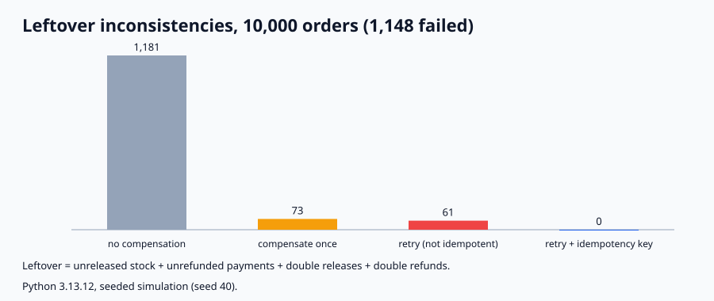

# 040. Saga 보상 처리: 중간 단계 실패 시 되돌린 건수와 남은 불일치

> 주문 1만 건을 재고 확보 → 결제 → 배송 등록 3단계로 처리했더니 1,148건이 중간에 실패했다. 되돌리지 않으면 재고 845건이 묶이고 결제 336건이 남았다. 보상을 1번만 시도하면 73건, 실패 시 재시도하면 응답이 유실된 보상이 두 번 반영돼 61건이 남았고, 멱등 키를 붙인 재시도는 0건이 됐다.

## 문제

여러 서비스에 걸친 작업(Saga)은 한 트랜잭션으로 묶을 수 없다. 3단계 중 뒤쪽이 실패하면 앞 단계를 거꾸로 되돌리는 보상(재고 해제, 환불)이 필요하다. 보상 호출도 실패하거나, 처리됐는데 응답만 유실될 수 있다. 이때 몇 건이 어긋난 채 남는지 잰다.

## 실험

- 주문 1만 건, 단계별 실패 확률: 재고 3%, 결제 5%, 배송 4%
- 보상 호출 결과: 90% 성공, 5% 요청 유실(반영 안 됨), 5% 반영됐지만 응답 유실
- 비교 4가지: 보상 없음 / 보상 1번만 시도 / 최대 5번 재시도(멱등 아님) / 최대 5번 재시도 + 멱등 키(같은 키의 보상은 한 번만 반영)
- 시나리오마다 난수가 쓰이는 흐름이 달라 실패 주문 수가 조금씩 다르다
- 시드 40이라 여러 번 돌려도 숫자가 같다. 파이썬 표준 라이브러리만 사용

```bash
python3 main.py              # 표 출력
python3 main.py --write-svg  # result.svg 다시 그리기
```

## 결과



| 방법 | 실패 주문 | 묶인 재고 | 남은 결제 | 재고 해제 중복 | 환불 중복 | 어긋난 건수 합계 | 보상 호출 수 |
|---|---:|---:|---:|---:|---:|---:|---:|
| 보상 없음 | 1,148 | 845 | 336 | 0 | 0 | 1,181 | 0 |
| 보상 1번만 시도 | 1,152 | 51 | 22 | 0 | 0 | 73 | 1,213 |
| 재시도 (멱등 아님) | 1,143 | 0 | 0 | 48 | 13 | 61 | 1,285 |
| 재시도 + 멱등 키 | 1,143 | 0 | 0 | 0 | 0 | 0 | 1,285 |

<sub>Python 3.13.12, macOS arm64, 시드 40 시뮬레이션. 여러 번 돌려도 숫자가 같았다.</sub>

## 배운 점

- 보상이 없으면 실패한 주문의 재고와 결제가 그대로 남는다. 실험에서 1,181건이었다.
- 보상을 한 번만 시도해도 90%는 되돌아가지만, 유실된 10%에서 73건이 남았다.
- 재시도하면 남는 건은 0이 되지만, "처리됐는데 응답만 유실"된 경우 같은 보상이 두 번 반영된다(재고 해제 48, 환불 13). 환불이 두 번 나가면 돈이 어긋난다.
- 보상에 멱등 키(주문 번호 + 단계)를 붙이면 재시도해도 한 번만 반영돼 어긋남이 0이 됐다. 호출 수는 같은 1,285회였다. 소비자 쪽 원리는 lab 032와 같다.
- 시뮬레이션이라 실제 서비스의 실패 확률·지연과는 다르다. 보상 자체가 계속 실패하는 경우는 사람이 보는 목록(수동 처리)이 따로 필요하다. 참고: [microservices.io, Saga pattern](https://microservices.io/patterns/data/saga.html), [Microsoft Learn, Saga distributed transactions pattern](https://learn.microsoft.com/en-us/azure/architecture/patterns/saga).
