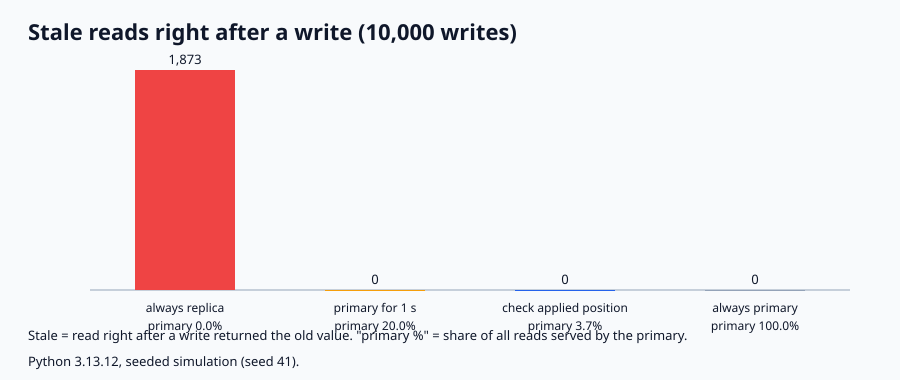

# 041. Read replica 지연: 쓰기 직후 읽기에서 옛 값을 읽는 비율

> 쓰기 1만 건 바로 뒤에 읽기를 했더니 replica만 읽는 방식은 1,873건(18.73%)이 옛 값을 돌려줬다. 쓴 뒤 1초는 primary를 읽으면 0건이지만 전체 읽기의 20.0%가 primary로 갔고, replica가 따라왔는지 확인하고 돌리면 0건에 primary 읽기는 3.7%였다.

## 문제

읽기 부하를 replica로 나누면, 방금 쓴 값을 바로 읽는 요청이 아직 복제가 안 된 replica에 닿을 수 있다. 사용자는 "저장했는데 안 보이는" 화면을 만난다. 그 비율과, 막는 방법별로 primary가 떠안는 읽기 비율을 잰다.

## 실험

- 쓰기 1만 건, 쓰기마다 바로 뒤 읽기 1번(쓰기 뒤 평균 150 ms 시점) + 쓰기와 무관한 읽기 4번
- 복제 지연: 평소 평균 30 ms, 3%는 평균 1,500 ms로 튄다
- 비교 4가지: 항상 replica / 쓴 뒤 1초는 primary / replica가 그 쓰기를 반영했는지 확인하고 아니면 primary / 항상 primary
- 시드 41이라 여러 번 돌려도 숫자가 같다. 파이썬 표준 라이브러리만 사용

```bash
python3 main.py              # 표 출력
python3 main.py --write-svg  # result.svg 다시 그리기
```

## 결과



| 방법 | 옛 값 읽기 | 비율 | primary 읽기 | 전체 읽기 중 primary |
|---|---:|---:|---:|---:|
| 항상 replica | 1,873 | 18.73% | 0 | 0.0% |
| 쓴 뒤 1초는 primary | 0 | 0.00% | 9,984 | 20.0% |
| 반영 위치 확인 후 replica | 0 | 0.00% | 1,873 | 3.7% |
| 항상 primary | 0 | 0.00% | 50,000 | 100.0% |

<sub>Python 3.13.12, macOS arm64, 시드 41 시뮬레이션. 여러 번 돌려도 숫자가 같았다.</sub>

## 배운 점

- replica만 읽으면 쓰기 직후 읽기 18.73%가 옛 값이었다. 평균 지연은 짧아도 튀는 3%가 읽기 간격보다 길어 대부분의 어긋남을 만든다.
- "쓴 뒤 1초는 primary"는 이 실험에서 옛 값이 0건이었지만, 쓰기 직후 읽기 전부가 primary로 가서 primary 읽기가 20.0%가 됐다. 지연이 1초를 넘으면 막지 못한다.
- 반영 위치(LSN, GTID 등)를 확인해 아직 안 따라온 요청만 primary로 돌리면 옛 값 0건에 primary 읽기 3.7%였다. 대신 읽기마다 위치를 비교하는 구현이 필요하다.
- 시뮬레이션이라 실제 DB의 지연 분포와는 다르다. 실제 지연은 DB의 복제 지연 지표로 먼저 확인한다. 참고: [Amazon Aurora, Replica lag](https://docs.aws.amazon.com/AmazonRDS/latest/AuroraUserGuide/AuroraMySQL.Replication.html), [PostgreSQL, Hot standby](https://www.postgresql.org/docs/current/hot-standby.html).
