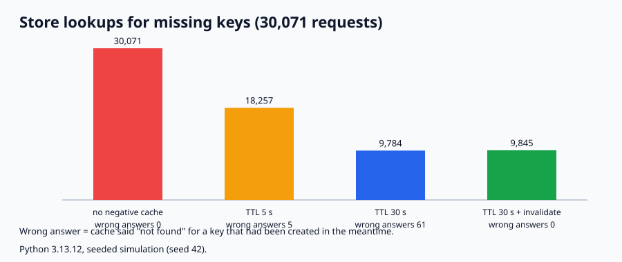

# 042. Negative caching: 없는 키 조회가 저장소까지 가는 횟수

> 요청 10만 건 중 없는 키를 찾는 3만 71건을 그대로 저장소에 보내면 3만 71번 조회했다. 부정 캐시 TTL 5초는 1만 8,257번(39.3% 절감), 30초는 9,784번(67.5% 절감)이었다. 대신 TTL 안에 만들어진 키를 "없음"으로 잘못 답한 횟수가 5초는 5건, 30초는 61건이었고, 키를 만들 때 부정 캐시를 지우면 0건이었다.

## 문제

존재하지 않는 키(삭제된 상품, 잘못된 ID, 크롤러 요청)는 캐시에 없어서 매번 저장소까지 간다. "없음"도 짧게 캐시하면 저장소 조회가 줄지만, 그 사이 키가 만들어지면 옛 "없음"을 돌려줄 수 있다. 줄어드는 조회와 틀린 답을 함께 잰다.

## 실험

- 요청 10만 건(1 ms 간격, 100초), 그중 30%가 없는 키 조회
- 없는 키 후보 5,000개, 앞쪽 키에 요청이 몰린다
- 후보 중 2%는 실험 도중 실제로 만들어진다
- 비교 4가지: 매번 저장소 / 부정 캐시 TTL 5초 / TTL 30초 / TTL 30초 + 키를 만들 때 부정 캐시 지우기
- 시드 42라 여러 번 돌려도 숫자가 같다. 파이썬 표준 라이브러리만 사용

```bash
python3 main.py              # 표 출력
python3 main.py --write-svg  # result.svg 다시 그리기
```

## 결과



| 방법 | 저장소 조회 | 절감 | 틀린 "없음" |
|---|---:|---:|---:|
| 없는 키는 매번 저장소 | 30,071 | 0.0% | 0 |
| 부정 캐시 TTL 5초 | 18,257 | 39.3% | 5 |
| 부정 캐시 TTL 30초 | 9,784 | 67.5% | 61 |
| TTL 30초 + 만들 때 지움 | 9,845 | 67.3% | 0 |

<sub>Python 3.13.12, macOS arm64, 시드 42 시뮬레이션. 여러 번 돌려도 숫자가 같았다.</sub>

## 배운 점

- 없는 키 조회가 몰리는 곳에서는 TTL이 길수록 저장소 조회가 많이 줄었다(5초 39.3%, 30초 67.5%).
- TTL이 길수록 만들어진 키를 "없음"으로 답하는 일도 늘었다(5건에서 61건).
- 키를 만들 때 그 키의 부정 캐시를 같이 지우면 절감은 67.3%로 거의 그대로고 틀린 답은 0건이었다.
- 시뮬레이션이라 실제 트래픽 분포와는 다르다. 실제로는 없는 키 조회 비율과 몰림 정도를 먼저 확인한다. 참고: [Redis, Client-side caching](https://redis.io/docs/latest/develop/use/client-side-caching/), [RFC 2308, Negative Caching of DNS Queries](https://www.rfc-editor.org/rfc/rfc2308).
