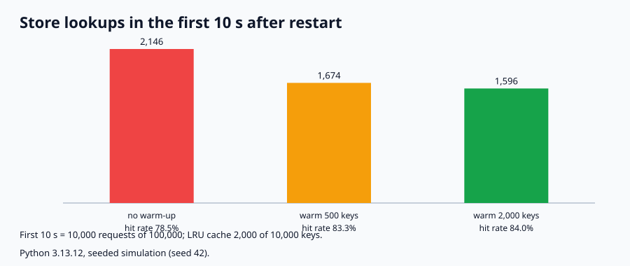

# 043. 캐시 워밍업: 재시작 직후 적중률과 저장소 조회

> 재시작한 캐시가 비어 있으면 처음 10초(요청 1만 건) 적중률은 78.5%, 저장소 조회는 2,146번이었다. 인기 키 500개를 미리 채우면 83.3%·1,674번(22.0% 감소), 2,000개를 채우면 84.0%·1,596번(25.6% 감소)이었다. 500개와 2,000개의 차이는 작았고, 미리 채우는 조회까지 합친 전체 저장소 조회는 15,919번과 17,341번(워밍업 없음 15,891번)이었다.

## 문제

캐시 서버를 재시작하면 캐시가 비어서 처음 몇 초 동안 요청이 저장소로 몰린다. 인기 키를 미리 채우면(워밍업) 그 구간이 나아지지만 미리 채우는 조회도 저장소가 받는다. 재시작 직후 구간과 전체 조회를 나눠서 잰다.

## 실험

- 요청 10만 건(1 ms 간격, 100초), 키 1만 개, 인기 키에 몰리는 분포(Zipf 지수 1.1)
- 캐시는 LRU, 2,000개까지 보관
- 비교 3가지: 워밍업 없음 / 인기 키 500개 미리 채움 / 인기 키 2,000개 미리 채움
- '재시작 직후'는 처음 10초(요청 1만 건)
- 시드 42라 여러 번 돌려도 숫자가 같다. 파이썬 표준 라이브러리만 사용

```bash
python3 main.py              # 표 출력
python3 main.py --write-svg  # result.svg 다시 그리기
```

## 결과



| 방법 | 처음 10초 적중률 | 처음 10초 저장소 조회 | 전체 저장소 조회(미리 채움 포함) |
|---|---:|---:|---:|
| 워밍업 없음 | 78.5% | 2,146 | 15,891 |
| 인기 키 500개 미리 채움 | 83.3% | 1,674 | 15,919 |
| 인기 키 2,000개 미리 채움 | 84.0% | 1,596 | 17,341 |

<sub>Python 3.13.12, macOS arm64, 시드 42 시뮬레이션. 여러 번 돌려도 숫자가 같았다.</sub>

## 배운 점

- 인기 키를 미리 채우면 재시작 직후 저장소 조회가 줄었다(2,146번에서 1,674번, 1,596번).
- 인기 순서대로 채우니 500개만으로도 줄어드는 폭의 대부분을 얻었다(22.0% 대 25.6%).
- 미리 채우는 조회도 저장소가 받는다. 전체로 보면 500개는 거의 같았고(15,919번), 2,000개는 더 많았다(17,341번).
- 시뮬레이션이라 실제 트래픽 분포와는 다르다. 실제로는 재시작 직후 구간의 저장소 여유와 인기 키 목록을 얼마나 최신으로 유지하는지를 함께 본다. 참고: [Redis, Persistence](https://redis.io/docs/latest/operate/oss_and_stack/management/persistence/).
