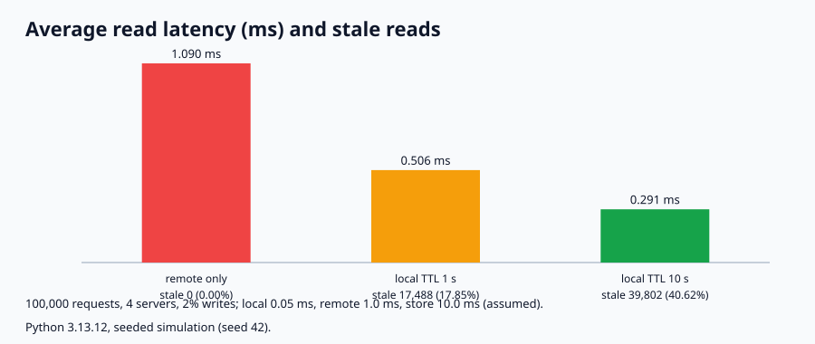

# 044. 2단계 캐시(로컬 + 분산): 적중 위치별 응답 시간과 서버 간 값 불일치

> 분산 캐시만 쓰면 읽기 평균 1.090 ms이고 옛 값은 0건이었다. 서버마다 로컬 캐시(TTL 1초)를 앞에 두면 61.5%가 로컬에서 끝나 평균 0.506 ms(53.6% 감소)가 됐지만 옛 값 읽기가 17,488건(17.85%)이었다. TTL 10초는 평균 0.291 ms(73.3% 감소)에 옛 값 39,802건(40.62%)이었다.

## 문제

분산 캐시(Redis 같은 곳)는 네트워크를 한 번 건너야 한다. 서버 안에 로컬 캐시를 앞에 두면 더 빠르지만, 다른 서버가 값을 바꿨을 때 내 로컬 캐시는 TTL이 끝날 때까지 옛 값을 들고 있다. 적중 위치별로 응답 시간을 재고, 옛 값을 읽은 건수를 센다.

## 실험

- 요청 10만 건(1 ms 간격, 100초), 키 1,000개, 인기 키에 몰리는 분포(Zipf 지수 1.1), 서버 4대에 무작위로 배정
- 쓰기 2%: 저장소와 분산 캐시를 바로 갱신하고, 쓴 서버의 로컬 캐시만 같이 갱신(다른 서버 로컬은 TTL 만료를 기다림)
- 응답 시간은 가정값: 로컬 0.05 ms, 분산 캐시 1 ms, 저장소 10 ms
- '옛 값'은 읽은 값의 버전이 그 순간 저장소의 최신 버전과 다른 경우
- 비교 3가지: 분산 캐시만 / 로컬 TTL 1초 + 분산 / 로컬 TTL 10초 + 분산
- 시드 42라 여러 번 돌려도 숫자가 같다. 파이썬 표준 라이브러리만 사용

```bash
python3 main.py              # 표 출력
python3 main.py --write-svg  # result.svg 다시 그리기
```

## 결과



| 방법 | 로컬에서 끝난 읽기 | 읽기 평균 응답 시간(ms) | 옛 값 읽기 |
|---|---:|---:|---:|
| 분산 캐시만 | 0.0% | 1.090 | 0 (0.00%) |
| 로컬 TTL 1초 + 분산 | 61.5% | 0.506 | 17,488 (17.85%) |
| 로컬 TTL 10초 + 분산 | 84.1% | 0.291 | 39,802 (40.62%) |

읽기는 97,985건이었다. 분산 캐시만 쓸 때 분산 캐시 97,009건·저장소 976건, TTL 1초는 로컬 60,249건·분산 36,760건·저장소 976건, TTL 10초는 로컬 82,368건·분산 14,641건·저장소 976건이 응답했다.

<sub>Python 3.13.12, macOS arm64, 시드 42 시뮬레이션. 여러 번 돌려도 숫자가 같았다.</sub>

## 배운 점

- 로컬 캐시를 앞에 두면 평균 응답 시간이 줄었다(1.090 ms에서 0.506 ms, 0.291 ms).
- 줄어든 만큼 옛 값 읽기가 늘었다(0건에서 17,488건, 39,802건). TTL이 길수록 더 많이 늘었다.
- 이 실험은 쓰기가 몰리는 인기 키가 많아서 옛 값 비율이 높게 나왔다. 쓰기 비율과 키 분포가 바뀌면 숫자도 달라진다.
- 옛 값이 문제가 되는 데이터는 로컬 TTL을 짧게 잡거나 무효화 알림을 함께 쓴다. 응답 시간은 가정값이라 실제 환경에서는 직접 재야 한다. 참고: [Redis, Client-side caching](https://redis.io/docs/latest/develop/clients/client-side-caching/).
