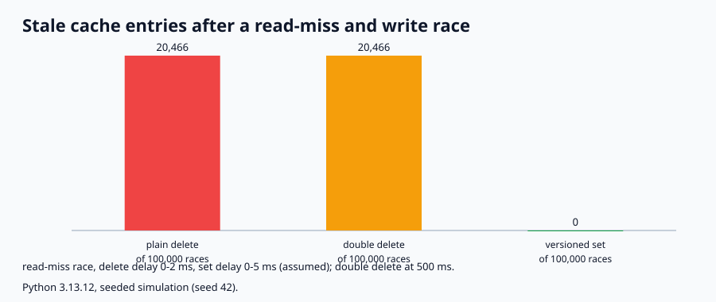

# 045. Cache-aside 갱신 경쟁: 늦게 도착한 옛 값이 새 값을 덮어쓰는 건수와 버전 확인

> 캐시가 비어 있을 때 읽기가 DB에서 옛 값을 받아 가고, 같은 순간 쓰기가 DB를 바꾸고 캐시를 지우면, 읽기 쪽 캐시 저장이 삭제 뒤에 도착해 옛 값이 남는다. 10만 번 중 20,466번에서 그런 경쟁이 생겼고, 삭제만 하는 방식은 옛 값이 TTL 10초 동안 남았다. 삭제를 500 ms 뒤 한 번 더 하면 평균 498 ms만 남았고, 버전을 비교해 옛 값을 거절하면 0건이었다.

## 문제

cache-aside에서 읽기는 "캐시 미스 → DB 조회 → 캐시 저장"을, 쓰기는 "DB 갱신 → 캐시 삭제"를 한다. 둘이 겹치면 순서가 뒤집힐 수 있다. 읽기가 DB에서 옛 값을 받은 뒤 네트워크나 GC 때문에 늦게 캐시에 넣으면, 쓰기가 이미 지운 캐시에 옛 값이 다시 들어간다. 이 실험은 그 경쟁 건수와 옛 값이 얼마나 남는지를 센다.

## 실험

- 시나리오 10만 번(시드 42). 각 시나리오는 캐시가 비어 있는 상태에서 읽기 1건과 쓰기 1건이 겹치는 경우다.
- 읽기의 DB 조회 시각은 쓰기 기준 -6 ms ~ +2 ms에 고르게 뽑는다(쓰기 전이면 옛 값을 읽음).
- 읽기 쪽 캐시 저장 지연 0~5 ms, 쓰기 쪽 캐시 삭제 지연 0~2 ms (가정값).
- 옛 값이 삭제 뒤에 저장되면 경쟁 발생. 이 모델에서 그 경우는 모두 캐시에 옛 값이 남는다고 본다(삭제가 한 번뿐이면 TTL까지 남음).
- 비교 3가지: 쓰기 뒤 삭제 / 500 ms 뒤 두 번째 삭제 / 버전 확인 후 저장(옛 버전이면 거절).
- 표준 라이브러리만 사용. 실제 Redis 대신 시뮬레이션이라 지연 값은 가정이고, 직접 측정이 필요하다.

```bash
python3 main.py              # 표 출력
python3 main.py --write-svg  # result.svg 다시 그리기
```

## 결과



| 방법 | 경쟁 발생(옛 값이 삭제 뒤 도착) | 캐시에 남은 옛 값 | 옛 값이 남은 평균 시간(ms) |
|---|---:|---:|---:|
| 쓰기 뒤 삭제 | 20,466 | 20,466 (20.47%) | 10,000 (TTL) |
| 500 ms 뒤 한 번 더 삭제 | 20,466 | 20,466 (20.47%) | 498 |
| 버전 확인 후 저장 | 20,466 | 0 (0.00%) | 0 |

<sub>Python 3.13.12, macOS arm64, 시드 42 시뮬레이션. 여러 번 돌려도 숫자가 같았다.</sub>

## 배운 점

- 삭제만 하는 cache-aside는 읽기와 쓰기가 겹치면 옛 값을 TTL까지 들고 있을 수 있다.
- 두 번째 삭제는 옛 값이 남는 시간을 TTL에서 500 ms 안쪽으로 줄이지만, 그 사이의 옛 값 읽기는 막지 못한다. 지연 삭제 시간이 늘어나면 그 뒤에도 남을 수 있다.
- 버전을 같이 저장하고 낮은 버전 저장을 거절하면 이 모델에서는 옛 값이 남지 않았다. 대신 저장소 쪽에 버전 열이나 CAS 같은 조건부 쓰기가 필요하다.
- 숫자는 가정한 지연과 경쟁 확률에 기대고 있다. 실제 서비스에서는 쓰기 빈도와 지연을 직접 재야 한다.
