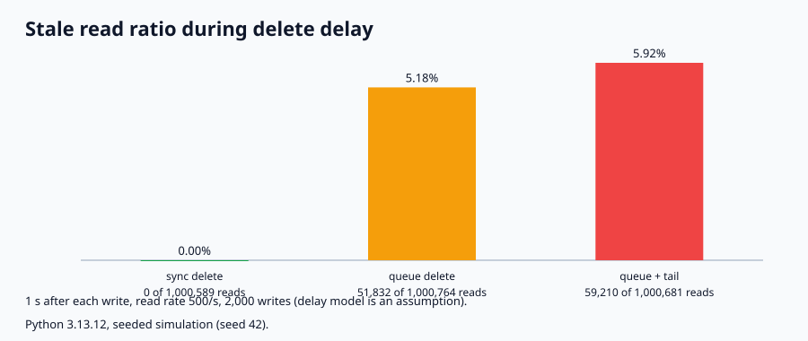

# 046. 캐시 무효화 지연: 삭제 메시지가 늦게 도착하는 동안 읽히는 옛 값 비율

> 캐시 삭제를 비동기 큐로 보내면, 쓰기 뒤 1초 동안 읽기 100만 번 중 옛 값을 읽은 건수는 평균 50 ms 지연 큐에서 51,832건(5.18%), 꼬리 지연을 섞으면 59,210건(5.92%)이었다. 같은 쓰기를 동기로 지우면 0건이었다.

## 문제

cache-aside에서 쓰기는 DB를 바꾼 뒤 캐시 삭제 메시지를 보낸다. 메시지가 큐에 쌓이거나 네트워크에서 늦어지면, 그 사이 읽기는 아직 지워지지 않은 옛 값을 받는다. 이 실험은 삭제가 도착하기 전까지 얼마나 많은 읽기가 옛 값을 보는지 센다.

## 실험

- 쓰기 2,000번(시드 42). 쓰기마다 캐시 삭제가 닿는 시각 d를 뽑고, 쓰기 뒤 1초 구간에서 읽기를 본다.
- 읽기 도착은 초당 500건(포아송 과정). 쓰기 뒤 d ms 전까지 읽기는 옛 값을 본다고 가정한다.
- 비교 3가지
  - 동기 삭제: d = 0
  - 비동기 큐: d ~ 지수 분포, 평균 50 ms
  - 큐 + 꼬리 지연: 95%는 평균 20 ms, 5%는 300~1,500 ms
- 표준 라이브러리만 사용. 지연 분포는 가정값이라 실제 큐 지연은 직접 재야 한다.

```bash
python3 main.py              # 표 출력
python3 main.py --write-svg  # result.svg 다시 그리기
```

## 결과



| 방법 | 읽기 수 | 옛 값 읽기 | 옛 값이 보인 평균 시간(ms) |
|---|---:|---:|---:|
| 동기 삭제 | 1,000,589 | 0 (0.00%) | 0.0 |
| 비동기 삭제 큐 (평균 50 ms) | 1,000,764 | 51,832 (5.18%) | 51.6 |
| 비동기 삭제 큐 + 꼬리 지연 | 1,000,681 | 59,210 (5.92%) | 59.3 |

<sub>Python 3.13.12, 시드 42 시뮬레이션. 큐 지연은 가정값이다.</sub>

## 배운 점

- 옛 값이 보이는 비율은 삭제 지연의 평균에 가까이 간다. 평균 50 ms면 1초 구간에서 약 5%가 옛 값이었다.
- 꼬리 지연은 옛 값 비율을 조금 올렸다(5.18% → 5.92%). 5%의 늦은 메시지가 최대 1.5초까지 가더라도 1초 구간 밖으로 밀린 만큼은 세지 않기 때문이다. 긴 꼬리는 읽기 구간을 넓혀 봐야 보인다.
- 삭제 지연을 줄이는 쪽이 가장 확실하다. 같은 요청 안에서 동기로 지우거나, 큐 지연을 재서 목표 시간을 정한다.
- 옛 값을 0으로 만들려면 삭제가 아니라 키 버전을 바꾸는 방식이 필요하다. 이건 다음 항목(키 버전 접두어)에서 따로 잰다.
