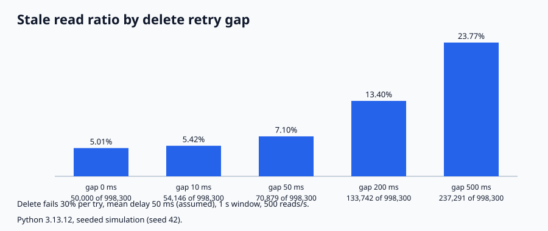

# 047. 삭제 재시도 간격: 실패한 캐시 삭제를 몇 ms 뒤에 다시 보내야 옛 값 구간이 줄어드는가

> 면접 질문: 캐시 삭제가 실패하면 언제 다시 보내야 하나요? 삭제를 바로 재전송하면 옛 값 읽기가 5.01%(50,000건)에서 멈추고, 500 ms 기다렸다 보내면 23.77%(237,291건)까지 늘어났다. 재시도 간격이 길수록 옛 값을 읽는 건수가 늘고, 보내는 횟수는 같다.

## 문제

cache-aside에서 쓰기 뒤 캐시 삭제가 실패할 수 있다. 실패한 삭제를 곧바로 다시 보내면 옛 값이 남는 시간이 짧아진다. 기다렸다 보내면 그 사이 읽기가 옛 값을 받는다. 이 실험은 재시도 간격에 따라 옛 값을 읽는 건수가 얼마나 달라지는지 센다.

## 실험

- 쓰기 2,000번(시드 42). 쓰기마다 삭제를 보낸다. 삭제 한 번은 30% 확률로 실패하고(가정), 성공할 때까지 최대 10번 보낸다.
- 삭제가 캐시에 닿기까지 지연은 평균 50 ms 지수 분포(가정). 실패 뒤에는 간격 ms를 기다렸다 다시 보낸다. 간격은 0, 10, 50, 200, 500 ms.
- 쓰기 뒤 1초 구간의 읽기는 초당 500건(포아송 과정). 성공한 삭제가 닿기 전까지 읽기는 옛 값을 본다.
- 표준 라이브러리만 사용. 실패율과 지연은 가정값이라 실제 캐시에서 직접 재야 한다.

```bash
python3 main.py              # 표 출력
python3 main.py --write-svg  # result.svg 다시 그리기
```

## 결과



| 재시도 간격(ms) | 읽기 수 | 옛 값 읽기 | 옛 값이 보인 평균 시간(ms) | 쓰기당 삭제 요청 |
|---:|---:|---:|---:|---:|
| 0 | 998,300 | 50,000 (5.01%) | 49.9 | 1.421 |
| 10 | 998,300 | 54,146 (5.42%) | 54.1 | 1.421 |
| 50 | 998,300 | 70,879 (7.10%) | 70.9 | 1.421 |
| 200 | 998,300 | 133,742 (13.40%) | 133.7 | 1.421 |
| 500 | 998,300 | 237,291 (23.77%) | 237.4 | 1.421 |

<sub>Python 3.13.12, 시드 42 시뮬레이션. 실패율 30%와 지연 평균 50 ms는 가정값이다.</sub>

## 대가

- 바로 재전송하면 옛 값 구간은 짧아지지만, 같은 키에 삭제 요청이 몰린다. 이 실험은 요청 수를 간격과 무관하게 같게 두었으니, 실제로는 재시도 폭주를 따로 막아야 한다(백오프 상한, 최대 횟수).
- 간격을 늘리는 것은 부하를 줄이지만 옛 값 비율을 올린다. 간격 200 ms에서 13.40%, 500 ms에서 23.77%였다.

## 배운 점

- 실패한 삭제는 기다릴수록 옛 값 구간이 길어진다. 평균 응답 시간이 50 ms인 삭제에서 500 ms를 기다리면 옛 값이 보인 평균 시간이 237 ms가 됐다.
- 재시도 간격이 0 ms와 10 ms일 때 차이가 작았다. 재전송 간격은 삭제 지연과 같은 자릿수로 줄이는 쪽이 낫다.
- 옛 값을 확실히 없애려면 재시도보다 키 버전을 바꾸는 방식이 필요하다. 다음 항목(키 버전 접두어)에서 따로 잰다.
