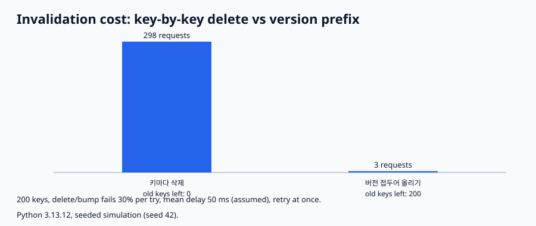

# 048. 캐시 키 버전 접두어: 한 번에 무효화할 때 삭제 요청 수와 옛 키가 남는 양

> 면접 질문: 캐시 키를 한 번에 무효화하려면 키마다 삭제하나요, 버전을 올리나요? 키 200개를 키마다 지우면 삭제 요청 298번이 나가고 옛 값 읽기는 5.53%다. 버전 접두어 하나를 올리면 요청은 3번으로 줄지만 옛 키 200개가 TTL까지 메모리에 남는다.

## 문제

한 가게의 메뉴 캐시 키 200개를 한 번에 무효화해야 할 때가 있다. 키마다 삭제하면 요청이 키 수만큼 나가고, 하나라도 실패하면 그 키만 옛 값이 남는다. 키 이름에 버전 번호를 넣으면(`menu:v7:shop:42`) 버전 하나만 올려 무효화할 수 있다. 대신 옛 버전 키는 지워지지 않고 남는다. 이 실험은 두 방식의 요청 수, 옛 값 읽기, 남는 옛 키 수를 센다.

## 실험

- 키 200개(시드 42). 키마다 삭제(방식 A)와 버전 번호 하나 올리기(방식 B)를 비교한다.
- 삭제 한 번(또는 버전 올리기 한 번)은 30% 확률로 실패하고(가정), 성공할 때까지 최대 10번 바로 재전송한다. 메시지가 닿기까지 지연은 평균 50 ms 지수 분포(가정).
- 무효화 뒤 1초 구간, 키 하나당 초당 500건 읽기(포아송 과정). 옛 값이 보이는 동안의 읽기를 옛 값 읽기로 센다.
- 버전 방식에서 새 버전 키는 처음 읽을 때 DB에서 채운다고 보고, 그 읽기는 옛 값으로 세지 않는다.
- 표준 라이브러리만 사용. 실패율·지연은 가정값이라 실제 캐시에서 직접 재야 한다.

```bash
python3 main.py              # 표 출력
python3 main.py --write-svg  # result.svg 다시 그리기
```

## 결과



| 방식 | 삭제·갱신 요청 수 | 옛 값 읽기 | 옛 값을 읽은 키 | 무효화 뒤 남는 옛 키 |
|---|---:|---:|---:|---:|
| 키마다 삭제 | 298 | 5,513 of 99,675 (5.53%) | 193 of 200 | 0 |
| 버전 접두어 올리기 | 3 | 6,560 of 99,675 (6.58%) | 200 of 200 | 200 |

<sub>Python 3.13.12, 시드 42 시뮬레이션. 실패율 30%와 지연 평균 50 ms는 가정값이다. 한 번의 실행 결과라 두 방식의 옛 값 비율 차이(5.53%와 6.58%)는 의미 있는 차이로 보지 않는다.</sub>

## 대가

- 버전 방식은 요청을 3번으로 줄이지만, 옛 키 200개가 TTL이 끝날 때까지 메모리를 차지한다. 키 수가 많고 TTL이 길면 이 비용이 커진다.
- 버전 방식에서 버전 올리기 요청 하나가 실패하면 묶음 전체가 옛 값을 읽는다. 키마다 삭제는 실패가 키 하나에만 걸린다. 그래서 이 실험에서 옛 값을 읽은 키 수가 200개 전부(버전) 대 193개(키마다)로 갈렸다.

## 배운 점

- 요청 수만 보면 버전 접두어가 훨씬 적다(298번 대 3번). 옛 값을 읽는 비율은 두 방식이 비슷했다.
- 키 묶음을 한 번에 바꿔야 하면 버전 올리기가 맞고, 옛 키가 남는 양을 메모리 예산과 TTL로 먼저 계산한다.
- 버전 올리기를 쓰면 버전 값 자체의 쓰기 실패 재시도 규칙(047의 재전송 간격)을 같이 둔다.
